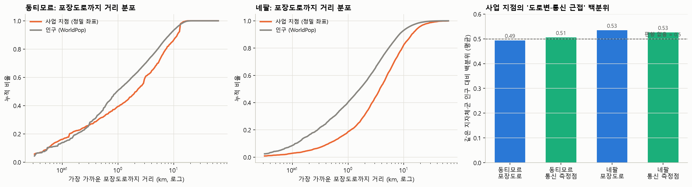

# 검토: 체임버스의 아스팔트 편향과 Ookla 자료의 타당성

작성일 2026-11-01 · 대상: 동티모르·네팔 페이퍼 (연구계획 v2)

---

## 1. 체임버스의 아스팔트 편향을 우리 자료로 어디까지 검증할 수 있나

Robert Chambers(1983, *Rural Development: Putting the Last First*)는 외부 전문가·공무원·연구자가 농촌을 짧게 방문하는 **'농촌개발 관광(rural development tourism)'**이 빈곤을 체계적으로 과소평가한다고 지적했다. 그가 든 편향은 다음과 같다.
- **공간 편향**: 도시와 아스팔트·도로변
- **사업 편향**: 이미 사업이 있는 곳으로 간다
- **사람 편향**: 엘리트, 남성, 사업 수혜자, 집에 있는 사람
- **계절 편향**: 건기 방문
- **외교적 편향**: 예의상 가난한 곳을 보지 않는다
- **전문가 편향**: 자기 전공 분야만 본다

체임버스의 편향은 원래 **'어디를 보고 누구를 만나는가'(관찰의 편향)**에 관한 것이다. 우리 연구는 **'어디에 사업을 두는가'(입지의 편향)**를 측정한다. 둘은 관련되지만 같지 않다. 관찰 편향이 사업 발굴·모니터링을 통해 입지 편향으로 이어진다는 것이 연결 고리다.

| 체임버스의 편향 | 우리 자료의 대응 지표 | 결과 | 판단 |
|---|---|---|---|
| **도시 편향** | 수도의 중앙기관 사업 비중, 지역 특정 사업 중 수도 점유율 | 중앙기관 사업이 금액의 동티모르 34%, 네팔 21%(IFC 이상치 제외). 지역 특정 사업은 수도가 인구 비례 이하(동티모르 12–14% vs 인구 26%, 네팔 10% vs 10%) | 지지. 단 형태가 '수도에 있는 기관을 통한 사업'으로 바뀜 |
| **아스팔트·도로변 편향** (단위 수준) | 포스토·군·palika의 우기 이동시간, 포장률, 도로밀도 | 사업 수에 효과 없음 또는 음(−) | 미지지 |
| **아스팔트·도로변 편향** (지점 수준) | 정밀 좌표 사업 지점에서 포장도로까지 거리를 **같은 지자체·군 인구의 거리 분포 백분위**로 환산 (0.5 = 편향 없음) | **동티모르**: 0.49 (SE 0.02), 편향 없음. **네팔**: 사업 가중 **0.42 (SE 0.016)**, 도로변 편향. 지점 가중으로는 0.54(반대) | 네팔에서 **부분 지지**. 전형적인 단일 사업은 도로변에 있고, 다지점 지역사회 사업은 오지까지 닿음 |
| **사업 편향** | 인프라·개발사업 이후 1–3년 다른 사업 유입(lag), 사전 위약(lead) | 두 나라 모두 lag 효과 없음. 네팔 전체 패널에서는 lead가 양(+) → 사업이 몰린 곳에 나중에 인프라가 들어감 | 사업이 사업을 부르는 '동반효과'는 미지지 |
| **계절(건기) 편향** | 우기 지연(우기 이동시간 − 건기 이동시간)의 비율 | 동티모르·네팔 모두 사업 수와 무관 | 미지지 |
| 사람·외교적·전문가 편향 | 관측 불가 | — | 질적 자료(공여기관 직원 인터뷰, 사업 발굴 문서)가 필요 |

### 1.1 해석: '아스팔트 편향'에서 '신호(통신) 편향'으로
- 체임버스가 관찰한 1970–80년대에는 외부인이 **자동차로 갈 수 있는 곳**만 봤다. 그래서 도로가 관찰과 사업 입지를 동시에 제약했다.
- 지금은 보고·모니터링·연락이 휴대폰과 인터넷으로 이뤄진다. 우리 결과(단위 수준에서 도로는 0, 통신은 일관되게 양)는 **편향의 제약 조건이 도로에서 통신 신호로 옮겨갔을** 가능성을 보여준다.
- 이 가설을 페이퍼에서 **'from tarmac bias to signal bias'**로 명명하고 체임버스의 틀을 업데이트하는 이론적 기여로 내세울 수 있다.
- **주의**: 지점 수준에서는 포장도로 근접과 통신 측정점 근접이 거의 같은 값으로 나온다(네팔 사업 가중 0.42 vs 0.42, 동티모르 0.49 vs 0.49). 도로변에 통신탑이 서기 때문이다. 그래서 **지점 수준에서는 둘을 분리할 수 없고**, 분리는 단위 수준 경쟁 모형(통신 vs 도로)에서만 가능하다.

### 1.2 이 검증의 한계
1. **위치의 정밀도**: AidData '정밀도 1' 좌표는 대개 마을(GeoNames 인구 지점) 중심이다. 실제 시설 위치가 아니다.
2. **도로망의 시점**: OSM 도로망은 현재 시점이다. 2000–2014년 사업 당시에는 포장되지 않았던 도로가 포함된다. 다만 이 오차는 사업이 도로에 가깝게 보이는 쪽으로 작동하므로, 동티모르의 '편향 없음'은 보수적인 결과다.
3. **가중 방식에 따라 결론이 달라진다(네팔)**: 페이퍼에서는 **사업 가중을 주 지표**로 쓴다. 공여기관의 입지 결정 단위는 사업이기 때문이다. 지점 가중은 보조로 함께 보고한다.

---

## 2. Ookla 자료는 적절한가

### 2.1 Ookla가 측정하는 것
- **사용자가 직접 실행한 속도 측정**을 줌 16 타일(약 600m)로 분기별 집계한 자료다(2019년부터).
- **커버리지가 아니다.** 측정한 사람이 있는 곳만 기록된다. 측정이 없다고 신호가 없는 게 아니다.
- **측정자는 스마트폰 보유자이고 앱을 쓰는 사람**이다. 도시·고소득·젊은층·외국인 직원에 치우친다. 통신사도 구분되지 않는다.

### 2.2 국가 간 비교 (저소득·하위중소득국, 1분기 모바일 측정, 인구 10만 명당)

| | 2019 Q1 | 2025 Q1 |
|---|---|---|
| 중앙값 | 9.5건 (65개국) | 18.8건 (68개국) |
| **동티모르** | **165건 (6위)**, 총 2,286건 | **206건 (5위)**, 총 2,848건 |
| 네팔 | 24건 (23위), 총 7,170건 | 21건 (33위), 총 6,191건 |
| 인구당 측정이 많은 나라 | 인도, 캄보디아, 부탄, 라오스, 볼리비아 | 튀니지, 볼리비아, 부탄, 파키스탄, 동티모르 |

→ 동티모르의 측정 밀도는 인구 대비로는 높다. 그러나 **절대량이 분기당 2–3천 건**에 불과하고 공간적으로 쏠려 있다.

### 2.3 국가 내 타당성

| 점검 | 동티모르 | 네팔 |
|---|---|---|
| 측정 0건인 단위 | 2019: 포스토 37/65, 2022: 25/65, 2025: 16/65 | 2019: 군 14/75, 2025: 3/75 |
| 수도권 측정 비중 vs 인구 | **딜리 81% (2019) → 60% (2025) vs 27%** | 카트만두 분지 48% vs 10% |
| 공식 가구조사와의 일치 (Spearman) | DHS 휴대폰 보유(지자체 13개)와 **−0.05 ~ +0.48, 연도마다 부호와 크기가 흔들림**. 딜리를 빼면 −0.34 ~ −0.02 | 센서스 2011 휴대폰 +0.48–0.54, 인터넷 +0.56–0.61 |
| 측정 타일 1.5km 안에 사는 인구 | 2019 36%, 2025 47% | — |
| 연도 간 안정성 (포스토 순위) | 2019–22: 0.72, 2019–25: 0.56 | — |

### 2.4 판단
- **동티모르**: Ookla는 **포스토 단위 통신 접근성의 주 지표로 부적절하다.** 절반 넘는 포스토가 측정 0건(2019)이고, 공식 조사와 일관된 관계가 없으며, 딜리 쏠림이 심하다. 지금 결과의 동티모르 '통신' 효과는 **'스마트폰 사용자가 있는 거점'** 효과로 읽어야 한다. 강건성이나 보조 지표로만 쓴다.
- **네팔**: 센서스와 중간 수준(0.5–0.6)으로 일치해서 **보조 지표로는 쓸 수 있다.** 주 지표는 센서스(2011·2021)다.
- **다른 나라로 넓힐 때**: Ookla 측정이 풍부한 저소득·하위중소득국(인도, 캄보디아, 부탄, 라오스, 볼리비아, 파키스탄)에서는 보조 지표로서 유용성이 더 높다. 그래도 커버리지가 아닌 '측정자 분포'라는 본질적 한계는 같다.

### 2.5 동티모르의 더 나은 대안 (우선순위)

| 순위 | 자료 | 측정 | 시점 | 단위 | 확보 방법 |
|---|---|---|---|---|---|
| 1 | **DHS GPS 클러스터 자료** (TLDHS 2009–10, 2016) | 가구 휴대폰 보유 (관측, 표본) | 2009–10, 2016 → **W1·W2와 정확히 정렬** | 클러스터(약 450–500개) → 포스토 집계 | DHS Program에 연구 목적으로 무료 등록·신청 (**연구자 본인 신청 필요**) |
| 2 | **센서스 2015·2022 포스토별 가구 ICT 표** | 가구 휴대폰·인터넷 (전수) | 2015, 2022 | 포스토·수코 | 통계청(INETL) 보고서·요청 |
| 3 | 규제기관·통신사 커버리지 (ANC, Telkomcel·Telemor·Timor Telecom) | 공급 측 커버리지 | 연도별 | 기지국·커버리지 | 기관 요청 |
| 4 | **OpenCelliD 기지국** (최초 관측일 포함) | 공급 측 기지국 위치 | 누적 | 지점 | 무료 API 토큰 (**연구자 본인 등록 필요**) |
| 5 | GSMA Mobile Coverage Explorer | 통신사 신고 커버리지 | 2010–2025 | 1km | 상용(학술 라이선스 문의) |
| — | Ookla | 측정자 분포 | 2019– | 타일 | 확보(보조) |

**네팔**도 같은 방식으로 보강할 수 있다. DHS GPS(2011, 2016, 2022)로 palika 수준 가구 휴대폰 보유를 만들면, palika 단위 분석의 통신 지표를 Ookla에서 관측 가구조사로 바꿀 수 있다.

---

## 3. 연구 계획에 반영할 변경

1. **동티모르 통신 지표**: 주 지표를 Ookla에서 **DHS GPS(2009–10, 2016) 포스토 집계**로 바꾼다. 확보되면 센서스 2015·2022 포스토 표로 보강한다. Ookla는 보조 지표가 된다.
2. **분석 창 재설계 (동티모르)**: W1(2008–2012, DHS 2009–10)과 W2(2014–2018, DHS 2016)를 포스토 단위로 분석한다. 그러면 **동티모르도 2시점 패널**이 된다.
3. **가설 H7 추가 (체임버스)**: "사업 지점은 같은 행정단위 인구보다 포장도로에 가깝다." 지점 수준 사업 가중 백분위로 검정하고, 단위 수준 통신 vs 도로 경쟁과 함께 '아스팔트 → 신호 편향' 논지로 제시한다.
4. **시각화 추가**: 포장도로 거리 누적분포(사업 vs 인구)와 백분위 막대(그림 [fig_tarmac.png](outputs/figures/fig_tarmac.png)). 이를 Fairbairn식 효과 행렬의 '지점 수준' 열로 통합한다.
5. **연구자가 직접 해야 할 일**: DHS GPS 자료 신청(동티모르·네팔), 필요하면 OpenCelliD 토큰 발급.

## 파일
- 결과: [results_tarmac.txt](outputs/results_tarmac.txt), [results_ookla.txt](outputs/results_ookla.txt)
- 표: [tarmac_bias.csv](outputs/tables/tarmac_bias.csv), [ookla_validity.csv](outputs/tables/ookla_validity.csv), [ookla_country_density.csv](outputs/tables/ookla_country_density.csv)
- 코드: [tarmac_bias.py](scripts/tarmac_bias.py), [ookla_validity.py](scripts/ookla_validity.py), [ookla_global.py](scripts/ookla_global.py)

