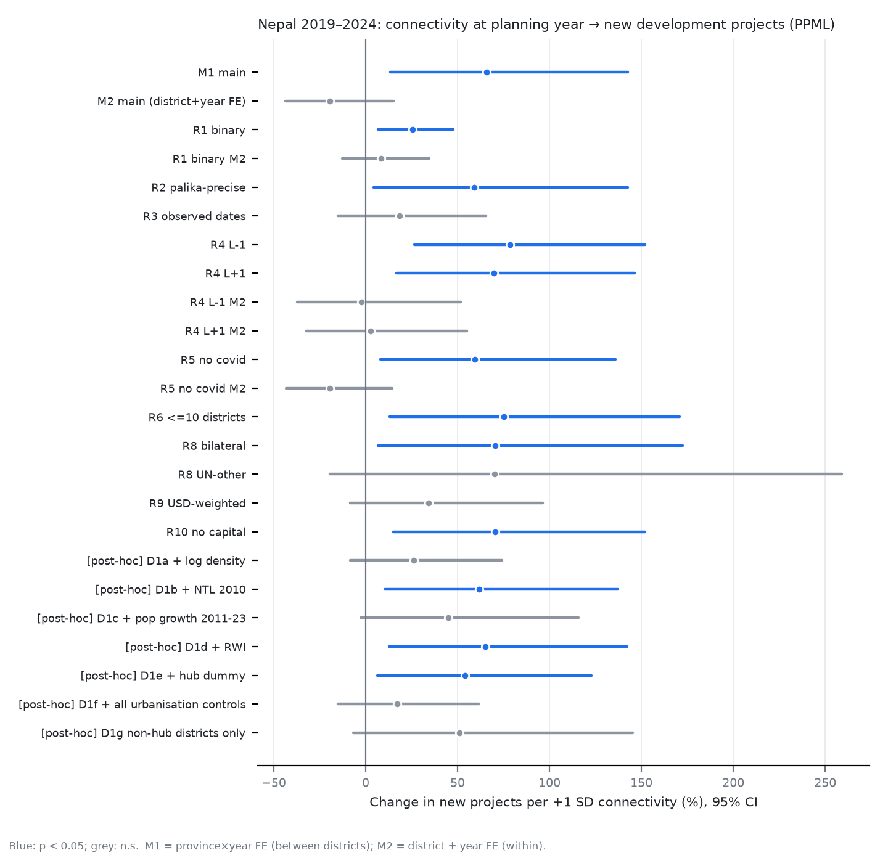

# 네팔 2019–2024: 기획 시점 정렬 설계 결과 (자율 작업 보고)

작성 2026-11-01 · 상태: **기계 코딩 완료, 인간 교차검증 전**. 아래 수치는 모두 검증 전 잠정치다.

---

## 1. 한눈에 보기
| 질문 | 답 (잠정) |
|---|---|
| 기획 착수 시점의 통신 수준이 높은 군에 신규 개발사업이 더 몰리는가? (사전등록 M1) | **그렇다.** 1 SD당 +66% (p = 0.009, Holm 보정 p = 0.028) |
| 한 군의 통신이 좋아진 해에 그 군의 신규 기획이 늘었는가? (사전등록 M2) | **판별 불가.** −19% (p = 0.23). 6년 패널에서 연도 효과를 뺀 군 내부 변동은 전체의 28%뿐이고, 그 편차의 AR(1)이 −0.18이다. 즉 지속적 개선이 아니라 평균회귀하는 측정 잡음에 가깝다. 계수가 0 쪽으로 감쇠됐을 가능성이 크다 → 장기 차분(센서스 2011→2021)으로 다시 검정해야 한다 |
| 도로 접근성은? | 사업 수 기준으로는 **0** (+18%, p = 0.55). **금액 기준으로는 강한 양(+)** (+480%/SD, p < 0.001) |
| 필요(박탈)는? | **0** (+3%, p = 0.83). 필요에 따른 배분의 증거가 없다 |
| M1 통신 효과는 견고한가? | **부분적으로만.** 사전등록 강건성 10개 중 8개에서 유지된다. 그러나 사후 진단에서 인구밀도·성장을 통제하면 사라진다 |

**해석**: 통신 수준은 '거점성'을 측정하는 지표로 보인다. 기획 시점 연결성이 사업을 끌어온다는 인과 신호로 보기는 어렵다. 이것은 이전 진단(시차 효과 = 성장 거점 신호)과 같은 결론이다. 이번에는 시점을 정확히 맞추고 새 표본에서 재현했다는 점이 다르다.

---

## 2. 이번에 새로 만든 데이터

### 2.1 지오코딩 v2 (AidData·UCDP 정밀도 체계)
- 대상: 2017–2025 착수 개발사업 3,504건(IATI + 세계은행).
- 지명 사전: 지방정부(palika) 753개의 변형 표기와 GeoNames 마을 83,577개, 총 87,447개 항목.
- 규칙(코드북: [np2_geo.py](scripts/np2_geo.py)):
  - V1: 마을 이름은 같은 텍스트에 그 군 이름이 함께 나올 때만 인정한다.
  - V2: palika 이름은 한 군에만 있는 이름일 때만 인정한다. 아니면 군 이름이 함께 나와야 한다.
  - V3: 수도 3군 이름이 IATI 구조화 필드(위치·연락처)에만 나오면 본부 소재지로 보고 제외한다.
  - V5: 군과 이름이 같은 마을은 군 단위로만 코딩한다. 주(province)·강 이름은 제외한다.
- 출처 결합: IATI 좌표, IATI 전문, ADB 사업정보표(PDS)의 '지리적 위치' 필드, 수집한 원문서(137건).
- 결과: **군 단위 이상 정밀도 22.3%**(782건), palika 이상 8.9%, 전국·중앙 76%.
- 오탐 사례를 직접 보고 고친 규칙이 있다.
  - 'Kathmandu'·'Parsa' 같은 마을명이 군 이름을 덮어쓰던 문제 → V5
  - "Kabhre Palanchok"에서 Palanchok palika가 따로 잡히던 문제 → 제외어 처리
  - WHO·BMZ 기록에서 'Kathmandu'가 본부로만 나오던 문제 → V3b

### 2.2 기획 착수 시점 (요청하신 대로 문서에서 직접 코딩)
| 코드 | 근거 | 사업 수 |
|---|---|---|
| O1 | ADB 사업정보표의 **개념 승인일**(Concept Clearance) | 32 |
| O1a | ADB 연속사업(2단계·추가재원): 사실조사일 − ADB 중앙 간격 | 4 |
| O2 | 세계은행 **개념 단계 PID 날짜**(WDS 문서 API) | 25 |
| O3 | IATI 기획 문서(평가·목적·MoU) 날짜. 시점의 상한이다 | 49 |
| S1 | 첫 약정일 − 중앙 승인시차 | 1,494 |
| E1 | 착수일 − 중앙 착수시차 | 1,900 |

- 금액 기준 **48%가 관측(O 코드) 날짜**다. 대형 사업이 대부분 MDB 사업이기 때문이다.
- **관측 시차**: 개념 단계 → 착수의 중앙값은 **0.86년**(사분위 0.52–1.42년, n = 57). 평균 2–4년이라던 이전 가정보다 짧다. 이전에 기각한 '9년 시차'는 실제 사업 주기와 전혀 맞지 않는다는 점이 문서로 확인됐다.
- 양자·UN 기관은 공개 기획 문서가 거의 없다. 그래서 S1·E1(추정)에 의존하고, 추정에 쓴 시차는 문헌 기본값이다(양자 1.5년, UN 1.0년). **약점이다.** R3(관측 날짜만) 분석은 61건뿐이라 검정력이 부족하다.

### 2.3 연도별 통신 지표 (2019–2025)
- Ookla 1분기 원자료를 연도별로 받아 군 단위로 집계했다. 지표는 4개다: 모바일 측정 건수/인구, 모바일 속도, 측정 타일 밀도, 유선 측정 건수/인구.
- PC1이 분산의 62%를 설명한다.
- 타당도: 2019년 지표와 센서스 2011 가구 인터넷 보급률의 Spearman 상관은 0.65, 컴퓨터 보유율과는 0.76이다.
- **군 내부 연도별 변동이 전체 변동의 40%**다. M2를 식별할 변이는 있다.
- 한계: 센서스 2021 군별 인터넷 표는 이 환경에서 NSO 포털에 접속할 수 없어 받지 못했다(아래 할 일 참조). 2022년에 유선 측정이 급증한 것은 Ookla 쪽 수집 방식 변화로 보인다. 연도 고정효과가 흡수한다.

### 2.4 사업별 한 장 요약 PDF
- [np2_project_summaries.pdf](outputs/project_summaries/np2_project_summaries.pdf): 금액 상위 400건, 한 쪽에 한 사업, 책갈피 포함. 쪽 번호와 사업 대조표는 [np2_summary_index.csv](outputs/project_summaries/np2_summary_index.csv)에 있다.
- 쪽마다 담긴 내용:
  - 예산, 상태, 착수·종료·승인일, ADB 마일스톤
  - **기계 코딩한 기획 시점과 근거 문장**
  - 목적: 세계은행 PAD에서 PDO를 자동 추출, 없으면 IATI 설명
  - **기계 코딩한 위치와 근거 인용문**, ADB '지리적 위치' 필드
  - 최신 문서 목록(날짜, 유형, URL)
  - 코더 확인란

---

## 3. 사전등록 분석 결과
- 계획서: [사전분석계획_네팔2019_2024.md](사전분석계획_네팔2019_2024.md). 추정 전에 작성했다.
- 표본: 위치를 확인한 사업 455건, 75개 군 × 기획연도 6개(2019–2024) = 450셀. 셀 평균 1.01건, 0인 셀 12%.
- 최소탐지효과(MDE): M1 통신 1 SD당 72%, M1 도로 118%, M2 통신 66%. **여전히 검정력이 낮다.** 효과가 1 SD당 30% 이하라면 탐지하지 못한다.

| 사양 | 통신 (1 SD당 %) | p | 도로 (1 SD당 %) | p |
|---|---|---|---|---|
| **M1 주모형** | **+66** | **0.009 (Holm 0.028)** | +18 | 0.55 (Holm 0.55) |
| **M2 군 내부** | −19 | 0.23 (Holm 0.47) | — | — |
| R1 이진 계수 | +26 | 0.006 | +30 | 0.25 |
| R2 palika 정밀도만 | +59 | 0.031 | +73 | 0.14 |
| R3 관측 기획일만 (61건) | +19 | 0.32 | **+166** | **0.007** |
| R4 기획 시점 −1 / +1년 | +79 / +70 | 0.001 / 0.005 | 거의 0 | — |
| R5 코로나 사업 제외 | +60 | 0.019 | +21 | 0.51 |
| R8 MDB (39건) | +24 | 0.32 | **+234** | **0.005** |
| R8 양자 (331건) | +70 | 0.026 | +21 | 0.56 |
| **R9 금액 가중** | +34 | 0.13 | **+480** | **< 0.001** |
| R10 수도 3군 제외 | +70 | 0.008 | −4 | 0.87 |

- 포장도로 밀도는 일관되게 음(−)이다(−13 ~ −32%). 박탈은 모든 사양에서 0이다.
- **사후 진단**(계획에 없던 분석, 그렇게 표시함): [results_np2_diagnostics.txt](outputs/results_np2_diagnostics.txt)
  - 인구밀도를 통제하면 통신 효과가 +26%(p = 0.16)로 줄고, 인구 성장을 통제하면 +45%(p = 0.07)로 줄어든다. 도시화 변수를 모두 넣으면 +17%(p = 0.34)다.
  - 야간 불빛, 부(RWI), 거점 더미는 효과를 없애지 못한다.
  - 위약 검정: 인도적 사업에서는 −46%(n.s.), 인프라 사업에서는 +64%(n.s., 38건)다.

---

## 4. 연구 방향에 대한 판단 (뒤플로식으로 냉정하게)

1. **'기획 시점 연결성 → 원조 입지'를 인과 주장으로 내기는 어렵다.**
   - 군 내부 변화(M2)는 0이다. 군 간 차이(M1)는 밀도·성장 통제에 민감하다.
   - 이전 단계와 마찬가지로, 통신은 '성장 거점'을 측정하고 있다.
2. **새로 드러난 견고한 대비 — 사업 수와 금액의 갈림.**
   - 사업 수(대부분 양자·소규모)는 거점·연결 지역을 따른다.
   - 금액(MDB 대형 사업)은 **도로 접근성을 강하게 따른다.** 관측 기획일만 쓴 표본(대부분 MDB)에서도 도로 +166%다.
   - 두 경우 모두 필요(박탈)를 따르지 않는다.
   - 체임버스의 아스팔트 편향은 '돈'의 수준에서는 살아 있다. '사업 개수' 수준에서는 거점 편향으로 나타난다.
   - 다만 MDB 위치 확인 사업이 39건뿐이고 금액 가중은 소수 대형 사업이 좌우한다. **확증이 아니라 다음 검정의 가설이다.**
3. **방법론 기여는 확실하다.**
   - 문서 기반 기획 시점 코딩을 했다(관측 시차 중앙값 0.86년).
   - 시점 불일치 편향을 실증했다(누적 설계에서 생기는 거짓 통신 효과).
   - AidData식 지오코딩 규칙을 오탐 사례와 함께 공개했다.
4. **제안하는 논문 틀 (방향 수정)**: "Projects follow hubs, money follows roads, neither follows need: time-aligned evidence on subnational aid allocation in Nepal". 동티모르는 비교 사례(박탈 음(−), 중앙기관 집중)로 둔다.
   - 확증 검정 후보(새로 사전등록): 금액 기준 모형에서 도로 계수 $\beta_R$.
   - 이 검정에 필요한 데이터: MDB 사업 위치를 하위사업(subproject) 목록에서 palika 단위로 코딩하는 작업(PAD·RRP 부록).

---

## 5. 아직 안 된 것 / 사용자 할 일
1. **인간 교차검증**(출판 전 필수): [np2_validation_sheet.xlsx](data/manual/np2_validation_sheet.xlsx)
   - 200건 층화 표본, 코드북·coder1·coder2 시트.
   - 요약 PDF 쪽 번호가 붙어 있어 함께 보며 코딩하면 된다.
2. **센서스 2021 군별 가구 인터넷 표**: censusnepal.cbs.gov.np에서 'Household' 결과 표를 직접 내려받아 주세요. 이 환경에서는 접속이 거부된다. 받으면 Ookla 지표의 2021년 보정·타당도에 쓴다.
3. DHS GPS 신청(기존 할 일): palika 단위 관측 통신 지표에 필요하다.
4. MDB 하위사업 위치 코딩: 다음 세션에서 이 작업을 하는 것이 위 4.2번 가설을 검증하는 가장 빠른 길이다.

## 파일
- 코드: [np2_s02_geocode.py](scripts/np2_s02_geocode.py), [np2_s03_docs.py](scripts/np2_s03_docs.py), [np2_s04_planning.py](scripts/np2_s04_planning.py), [np2_s05_summaries.py](scripts/np2_s05_summaries.py), [np2_s06_connectivity.py](scripts/np2_s06_connectivity.py), [np2_s07_panel.py](scripts/np2_s07_panel.py), [np2_s08_diagnostics.py](scripts/np2_s08_diagnostics.py), [np2_s09_validation_figs.py](scripts/np2_s09_validation_figs.py)
- 데이터: [np2_geocodes.csv](data/processed/nepal/np2_geocodes.csv), [np2_planning.csv](data/processed/nepal/np2_planning.csv), [np2_connectivity.csv](data/processed/nepal/np2_connectivity.csv), [np2_panel.csv](data/processed/nepal/np2_panel.csv), [adb_pds_milestones.json](data/interim/adb_pds_milestones.json)
- 결과: [results_np2_panel.txt](outputs/results_np2_panel.txt), [np2_panel_results.csv](outputs/tables/np2_panel_results.csv), [np2_fig2_planning_lag.png](outputs/figures/np2_fig2_planning_lag.png)
