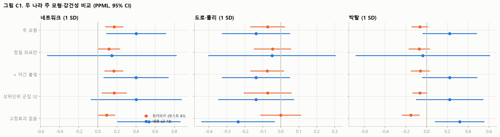
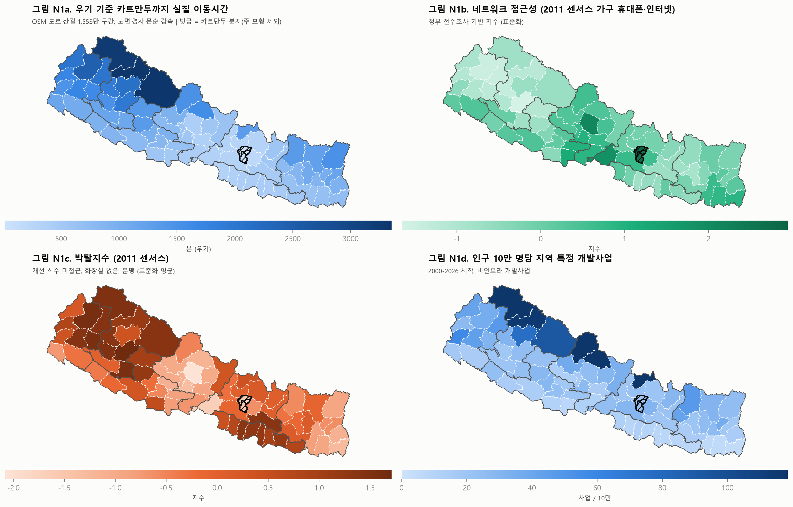
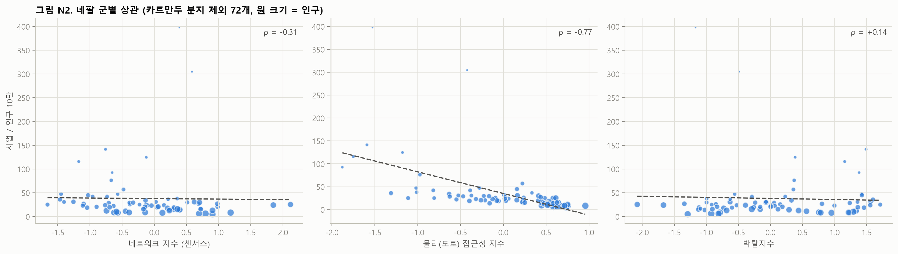

# 네팔 재현 분석과 동티모르 비교 (프로토콜 v1 적용)

작성일 2026-11-01 · 분석 단위: 군(district) 75개(2011년 경계, 나왈파라시·루쿰 통합) · 주 모형 표본: 카트만두 분지 3개 군 제외 72개 · 고정효과: 주(province) 7개

---

## 요약

| 질문 | 동티모르 (포스토 61) | 네팔 (군 72) | 일반화 판단 |
|---|---|---|---|
| **H1a 네트워크 접근성** | +0.172 (p < 0.001) | **+0.401 (p = 0.012)**, 순열검정 p = 0.002 | **두 나라 모두 지지** |
| H1b 도로·물리 접근성 | −0.073 (p = 0.14) | −0.138 (p = 0.16) | **두 나라 모두 기각** (0 또는 음) |
| 도로 vs 네트워크 모형 비교 | 네트워크 단독이 최적, 상호작용 0 | 네트워크 단독 AIC 817 vs 도로 단독 856, 상호작용 0 | **일관됨** |
| H1c 필요(박탈) | 박탈된 곳이 덜 받음 (지자체 간) | **박탈된 곳이 더 받음** (+0.22, 고정효과 없이 +0.32, p = 0.009) | **나라마다 다름** |
| H3 인프라 동반효과 | 없음 | 없음 (시작 후 1–3년 p = 0.16). 오히려 개발사업이 많아진 곳에 인프라가 나중에 들어옴 | **일관됨** (인프라 → 사업 아님) |
| H4 역인과 (사업 → 인구) | 없음 | 없음 (p = 0.94). 다만 인구가 늘어난 군에 이후 사업이 더 감(p = 0.005) | 사업이 인구를 끌지는 않음 |
| ICT 사업의 수도 집중 | 중앙기관 경로: ICT 62% vs 비ICT 32% | 중앙기관 경로: **ICT 31% vs 비ICT 17%**. 지역사업 안에서는 수도 집중 없음 | **일관됨** |
| 수도 집중 | 지역사업은 인구보다 적음(11.7–14.3% vs 26%), 중앙기관 사업이 금액 34% | 지역사업은 인구 비례(10.2% vs 9.5%), 중앙기관 사업이 금액 21% (IFC 이상치 제외) | **"수도 집중 = 중앙기관 사업"으로 일관** |

**결론**: 두 나라에서 같은 결론이 나온다. 공여기관의 지역 내 입지를 설명하는 것은 **도로가 아니라 통신망 접근성**이다. 인프라 사업이 들어간다고 다른 사업이 따라오지도 않는다. 반면 **필요에 대한 반응은 나라마다 반대**다. 동티모르는 박탈된 곳을 덜 지원하고, 네팔은 더 지원한다. 그러니 "접근성 편향"과 "빈곤 역표적"은 별개의 현상으로 다뤄야 한다. 이론적 기여는 이 두 가지를 분리했다는 점이다.

---

## 1. 데이터

| 항목 | 네팔 |
|---|---|
| 사업 DB | 고유 사업 9,808건(2000–2026): AidData 네팔 AIMS 829, 지진 재건 156, IATI 8,805(AIMS와 중복 214건 제거), 세계은행 18 |
| 위치 배정 | 군 단위 A 295 / B 1,667 / C(상위 단위 분할) 139건. IATI 전체 기록(1.1GB) 텍스트 활용. 상위 60건(미확인 금액의 64%) 수작업 검토 |
| 대상 유형 (금액) | 지역 특정 30%, 중앙기관 34%(IFC 무역금융 70억 달러 이상치를 빼면 21%), 전국 보편 10%, 미확인 26% |
| 지명 사전 | 75개 군의 표기 변형과 주요 도시, 2015년 이전 문서의 14개 존·5개 개발권역, 7개 주(상위 단위 → 소속 군 분할) |
| **네트워크** | **2011 센서스 가구 휴대폰·인터넷 보유율 (정부 전수조사, 사업 이전 시점)**. Ookla 2019·2025는 보조 |
| 물리 접근성 | OSM 도로·산길 1,553만 구간, 희소 그래프 최단경로로 카트만두까지 건기·몬순 이동시간. 포장률, 도로밀도, 급경사 비율, 몬순 지연 |
| 필요 | 2011 센서스 박탈지수: 개선 식수(수도·관정·덮개 우물) 미접근, 화장실 없음, 문맹 |
| 기타 | 2011·2023 인구(증가율), 2010 야간 불빛, Meta RWI |

## 2. 주 모형과 강건성 (PPML, 1 SD)

| 모형 | 도로 | 네트워크 | 필요 |
|---|---|---|---|
| **주 모형** | −0.138 (0.155) | **+0.401 (0.012)** | +0.222 (0.098) |
| 정밀 좌표만 | −0.049 | +0.146 (0.67) | −0.037 |
| 등급 C 포함, 고정효과 없음 | −0.120 | +0.305 (0.006) | +0.197 (0.009) |
| + 야간 불빛 2010 | −0.138 | +0.400 (0.021) | +0.222 |
| 주 군집 표준오차 (7개) | | +0.401 (0.098) | |
| RWI로 필요 대체 | −0.106 | +0.328 (< 0.001) | RWI 빈곤 +0.337 (< 0.001) |
| 시기 1 (≤ 2014, AIMS) | −0.096 | +0.275 (0.18) | +0.232 |
| 시기 2 (≥ 2015) | −0.167 | +0.479 (0.006) | +0.222 |
| 카트만두 분지 포함 | −0.208 (0.041) | +0.419 (0.009) | +0.264 (0.049) |
| 지진 관련 사업 제외 | +0.006 | +0.532 (0.008) | +0.234 |
| Ookla로 네트워크 대체 | −0.043 | Ookla +0.154 (0.015) | |
| 센서스와 Ookla 동시 투입 | | 센서스 +0.335 (0.053), Ookla +0.092 (0.19) | |

괄호 안은 p값이다.

- 주를 하나씩 빼면 네트워크 계수는 +0.26 ~ +0.55 범위로 모두 양(+)이다. 주 안에서 네트워크 값을 섞는 순열검정은 p = 0.002다.
- **주의할 점**:
  1. 네트워크와 박탈지수의 상관이 −0.84로 매우 높다. 두 변수를 함께 넣은 계수는 "박탈 수준이 같을 때 통신이 더 되는 군"의 효과로 읽어야 한다.
  2. 정밀 좌표(A, 주로 AIMS 시기)만 쓰면 효과가 흐려진다. 결과는 주로 2015년 이후 텍스트 배정 사업에서 나온다.
  3. 상위 단위 군집이 7개뿐이라 군집 표준오차가 보수적이다(p = 0.098).

## 3. 이질성 (부문·ICT·규모·기간·공여 유형, BH q < 0.05만)
- **네트워크 민감**: 에너지 인프라(+0.77, Holm 0.025), 소규모 사업(+1.24, Holm 0.039), 보건, ICT 요소 사업, 비ICT 사업, 단기·중기 사업, 양자 공여, 다자·UN 공여
- **박탈된 곳으로 감**: 보건, 기타 사회, 거버넌스, ICT 요소, 대규모, 중기, 다자·UN
- **도로 접근이 나쁜 곳으로 감**: 식수·위생, 인도적 지원(동티모르와 같음)

## 4. 정책·이론 함의
1. **"인프라 먼저 → 균형발전" 처방은 두 나라 모두에서 뒷받침되지 않는다.** 도로 접근성은 사업 입지를 설명하지 못하고, 인프라 사업 뒤에 다른 사업이 따라오지도 않는다.
2. **사업 입지의 공통 결정 요인은 통신망이다.** 원격 모니터링, 보고, 현장 연락이 가능한 곳을 고르는 공여기관의 행태와 맞는다. 메커니즘 검증(직원 인터뷰·컨조인트)이 다음 과제다.
3. **필요 반응은 국가 맥락에 달려 있다.** 네팔처럼 연방화·지방정부 배분 공식과 빈곤 지도가 정착된 곳에서는 박탈된 곳으로 사업이 가는 반면, 동티모르는 그렇지 않다. 수원국 정부의 배분 체계가 조절변수일 수 있다.
4. **수도 집중은 지역사업이 아니라 중앙기관 사업에서 나온다.** 그리고 ICT 요소 사업은 그 경로로 두 배가량 더 몰린다.

## 5. 한계와 다음 단계
- 사람 검증은 아직 하지 않았다. 동티모르 216건 검증 표본처럼 네팔 표본도 만들어야 한다.
- 네팔 도로 개량 효과(H2)는 구간별 완공 연도 자료가 필요해서 이번에 분석하지 않았다.
- 2021 센서스 군별 가구 ICT 자료를 확보하면 시기 2 네트워크 지표를 갱신할 수 있다.
- palika(753) 보조 분석은 아직 하지 않았다. 정밀 좌표가 16,628개라 군 고정효과 설계로 확장할 수 있다.
- 네트워크와 박탈의 공선성(ρ = −0.84) 때문에 두 효과의 분리가 불완전하다. palika 단위에서 군 고정효과를 넣으면 개선될 것이다.

## 6. 파일
- **결과 원문**: [results_nepal.txt](outputs/results_nepal.txt)
- **표**:
  - [nepal_robustness.csv](outputs/tables/nepal_robustness.csv)
  - [nepal_roads_vs_network.csv](outputs/tables/nepal_roads_vs_network.csv)
  - [nepal_sector_family.csv](outputs/tables/nepal_sector_family.csv)
  - [nepal_manual_codes_with_titles.csv](outputs/tables/nepal_manual_codes_with_titles.csv)
- **그림**:
  - [nepal_fig01_maps.png](outputs/figures/nepal_fig01_maps.png)
  - [nepal_fig02_scatter.png](outputs/figures/nepal_fig02_scatter.png)
  - [compare_fig01_coefficients.png](outputs/figures/compare_fig01_coefficients.png)
- **코드 실행 순서**:
  1. `nepal_fetch1.py`
  2. `nepal_fetch2.py`
  3. `fetch_ntl.py`
  4. `nepal_s01_units.py`
  5. `nepal_s02_access.py`
  6. `s03b_iati_text.py nepal`
  7. `nepal_s03_oda.py`
  8. `nepal_dump_unresolved.py`
  9. `nepal_s03c_manual.py`
  10. `nepal_s05_analysis.py`
  11. `nepal_s06_figures.py`

