# 동티모르 ODA 사업지 선정의 접근성 편향: 포스토 단위 실증분석

작성일 2026-11-01 · **분석 v2.0** (v1.0: 2026-10-31) · 분석 단위: 포스토(행정구) 62개 (딜리 도심 4개 포스토 통합)

---

## 요약

| 질문 | v2 결과 | 판정 |
|---|---|---|
| **전국 단위 사업도 대상 지역이 있나?** | 있다. 텍스트를 넓히고 시설·수코 지명을 추가하고 상위 110건을 수작업 검토한 결과, **금액 기준 48%가 지역 특정, 25%가 중앙기관(딜리), 10%가 전국 보편, 15%가 미확인**이다. v1의 "77%가 전국 단위"는 지역 정보 추출이 부족해서 나온 수치였다. | **v1 수치 정정** |
| **수도 집중** | 지역 특정 사업 중 딜리 도심 점유율은 25.5%로 인구 비중(26%)과 비슷하다. 그러나 인구 규모로 예측되는 것보다 **4.5배 많고**, 여기에 중앙기관 사업(금액의 25%)이 더해진다. | 수도 집중은 **"딜리 지역사업 + 중앙기관 사업"** 두 층으로 존재 |
| **접근성 편향 (H1)** | 같은 지자체 안에서 접근성 1 SD 높은 포스토가 사업이 약 19% 많다(p = 0.004). 지자체 소재지 여부를 통제해도 그대로다. | **지지**: 지역 안 거점 선택 |
| **도로 vs 네트워크** | **네트워크가 주된 동인이다.** 네트워크만 넣은 모형이 가장 좋고(AIC 387), 도로를 함께 넣어도 설명력이 늘지 않는다. 상호작용도 없다(p = 0.88). 지자체 안에서는 네트워크 +0.20(p < 0.001), 도로 −0.09(p = 0.04)다. | 네트워크 > 도로 |
| **1인당 동일 = 인구가 사업을 따라간 결과?** | 아니다. 2006–10년 사업은 2010–15년 센서스 인구 증가를 예측하지 못하고(p = 0.93), 인구 증가도 이후 사업을 끌어오지 않는다(p = 0.88). | 역인과 **기각** |
| **가난한 곳이 덜 받나?** | 센서스 박탈지수(2010) 기준으로 1 SD 더 박탈된 포스토는 정밀 위치 사업이 약 13% 적다(p = 0.003). | 빈곤 역표적 (Briggs와 같은 방향) |
| **부문별 차이** | 생산부문(+0.15, p = 0.008)과 거버넌스(+0.09, p = 0.056)는 네트워크에 민감하다. 보건과 기타 사회 사업은 박탈된 곳으로 간다. 교육은 도로 접근이 나쁜 곳에 더 많다. 인도적 지원은 오지로 간다. | 부문마다 입지 논리가 다름 |
| **ICT 요소 사업** | 지역 특정 ICT 사업의 **39%가 딜리**에 있다(비ICT 24%, 인구 26%, χ² p < 0.001). 지방 포스토 사이에서는 네트워크 민감도 차이가 없다. | **수도-지방 수준에서 지지**, 지방 내부에서는 미지지 |
| **규모·기간** | 대규모(> 82만 달러), 단기(≤ 2년), 장기(≥ 6년) 사업에서 네트워크 효과가 유의하다. 다만 유형 간 차이 검정은 유의하지 않다. | 차이 없음 |
| **도로 개량 효과 (H2)** | 측정 방식이 일정한 예산서 패널에서도 개량 후 사업은 늘지 않았다(IRR 0.68, p = 0.25). 동부(바우카우·라우템)의 사업 점유율은 완공 후 21% → 13%로 오히려 줄었다. | **"인프라 → 사업 유입" 미지지** |
| **인프라 사업 동반효과** | 인프라 사업 이후 1–3년 내 다른 사업 유입 효과는 없다(p = 0.83). 사전(lead) 위약 검정도 0이다. | 동반효과 없음 |

**종합**: 공여기관은 수도에 중앙기관 사업을 몰고, 지방에서는 **도로보다 통신망이 닿는 거점 포스토**를 골라 사업한다. 같은 지자체 안에서 그렇고, 박탈된 포스토는 덜 받는다. 그러나 도로를 깔아준다고 그 지역으로 사업이 따라 들어오지는 않았다. **"인프라 먼저 → 균형발전"이라는 처방은 동티모르 데이터로 뒷받침되지 않는다.** 오히려 통신망 접근성이 사업 입지와 더 밀접하다.

---

## 0. v1 → v2 변경 사항

| 항목 | v1 | v2 |
|---|---|---|
| 지역 추출 텍스트 | 제목 + 짧은 설명 | AMP 기대성과·최종성과·수혜기관 필드, **IATI 전체 기록(842MB)**의 설명·위치명·성과지표·문서 제목, 세계은행 PDO |
| 지명 사전 | 포스토 65개 + 지자체 13개 | + **수코 약 400개**, 시설명(니콜라우 로바투 공항, 국립병원, 티바르 항, 딜리 항 등), 일본어·테툼어 표기. 오탐 감사 후 사무소 주소·포르투갈어 'Com'·'Maubisse Declaration' 제외 |
| 미배정 사업 처리 | 전국 단위로 일괄 처리 | **지역 특정 / 중앙기관 / 전국 보편 / 지역 외 / 미확인**으로 분류. **금액 상위 110건 수작업 코딩**, 근거는 [manual_target_codes_with_titles.csv](outputs/tables/manual_target_codes_with_titles.csv)에 기록 |
| 필요 변수 | Meta RWI | + **2010 센서스 박탈지수**(개선 식수·위생 미접근, 청년 문맹, 비청정 연료, 중등 미취학) |
| 인구 | WorldPop | + **센서스 2010·2015**(포스토 합계가 공식 전국 인구와 정확히 일치), 2022년(27개 포스토) |
| 예산서 | 합계 행 혼입 | 공여기관 합계·비율표 행 제거, 연 1억 달러 초과 금액 제외 |
| 추가 변수 | — | 사업 종료연도(기간), 규모 3분위, ICT 요소 플래그, 지자체 소재지 포스토 |

연구자 판단 (PI 확인):
1. 딜리 도심 4개 포스토는 하나로 통합했다.
2. 지자체 단위 사업은 균등 분할하고, 정밀 위치만 쓴 결과도 함께 보고한다.
3. 주 종속변수는 사업 수다.
4. 접근성은 주성분 종합지수와 구성요소를 함께 쓴다.
5. **중앙기관 사업은 별도 지표로 분리**했다.
6. **미확인 사업은 상위 110건만 수작업 검토하고 나머지는 공간 분석에서 제외**했다.

---

## 1. 데이터 요약

- **사업 DB**: 고유 사업 3,982건(2000–2026 시작)이다.
  - 출처별: AidData AMP 907건, IATI 2,094건, 세계은행 26건, 예산서 1,048건(중복 제외 후)
  - 대상 유형별(그림 14):

| 대상 유형 | 사업 수 | 금액 비중 |
|---|---|---|
| 지역 특정 | 1,326 | 48% |
| 중앙기관 | 884 | 25% |
| 전국 보편 | 74 | 10% |
| 미확인 | 1,598 | 15% |
| 지역 외 | 100 | 2% |

- **ICT 요소 사업**: 349건이다. 텍스트에 정보시스템, 디지털, e-거버넌스, 연결성 등이 나오는 사업이다.
- **접근성**(v1과 동일): OSM 도로망 기반 우기 실질 이동시간, 포장률, 도로밀도, 급경사 비율, 우기 지연, Ookla 측정 타일·측정 수 → 주성분 종합지수.
- **검증**: 재무부 예산서 공식 지자체별 사업 수(2016–17)와 비교하면 Pearson r = 0.71, Spearman ρ = 0.30이다(v1 0.61/0.26보다 개선).

---

## 2. 결과

### A. 1인당 동일 현상은 "인구가 사업을 따라간" 결과인가? (그림 17)
물으신 그대로, 사업이 많은 곳으로 사람이 모여서 1인당 차이가 사라졌을 가능성을 시점을 나눠 검증했다.

| 검정 | 결과 |
|---|---|
| A1. 2006–10년 사업(1인당) → 2010–15년 센서스 인구증가율 | b = +0.09, p = 0.93 |
| A2. 위 모형 + 지자체 고정효과 | b = −0.52, p = 0.76 |
| 단순 상관 (Spearman) | ρ = +0.14, p = 0.28 |
| A4. 반대 방향: 2010–15년 인구증가 → 2016–25년 사업 | b = −0.007, p = 0.88 |
| A5. WorldPop 2015–20 증가율 ← 2000–15년 사업 | b = −2.8, p < 0.001 (모델 추정치라 해석 제한) |
| A6. 사전 인구(2010)를 쓴 인구 탄력성 | 0.38 (2022년 인구를 쓰면 0.44–0.47) |

→ **사업이 인구를 끌어들였다는 증거는 없다.** 사업 이전 시점 인구로 바꿔도 탄력성은 1보다 훨씬 작다. 공여기관이 "인구 비례"보다 "포스토마다 일정 수" 방식으로 배분한다는 해석이 유지된다. 1인당이 같아 보이는 것은 인구 이동 때문이 아니라 이 배분 방식 때문이다.

### B. 도로 vs 네트워크 (그림 16, 15)
**모형 비교** (정밀 위치 사업, PPML, 딜리 제외, log 인구·박탈지수 통제)

| 모형 | 도로·물리 | 네트워크 | 상호작용 | AIC |
|---|---|---|---|---|
| 도로만 | +0.015 (p = 0.79) | | | 393.8 |
| **네트워크만** | | **+0.108 (p = 0.030)** | | **387.2** |
| 둘 다 | −0.010 (p = 0.86) | +0.111 (p = 0.025) | | 389.2 |
| 둘 다 + 상호작용 | −0.010 | +0.112 (p = 0.021) | −0.007 (p = 0.88) | 391.1 |
| 종합지수 PC1 | | | | 389.8 (b = +0.087, p = 0.15) |

- **두 요소를 결합해도 통계적으로 나아지지 않는다.** 종합지수는 오히려 네트워크 단독 모형보다 성능이 떨어진다. 도로 요소가 잡음을 더하기 때문이다.
- 상호작용이 0이므로 "도로와 통신이 함께 갖춰져야 사업이 온다"는 시너지는 보이지 않는다.
- 2×2 집단(인구 1만 명당 정밀 위치 사업): 네트워크만 높음 15.1 > 둘 다 낮음 12.9 > 둘 다 높음 11.7 > 도로만 높음 9.4.
- **7개 구성요소를 동시에 투입**하면 Ookla 측정 타일만 경계적 유의(+0.197, p = 0.060)하고 나머지는 모두 0 근처다. 두 Ookla 변수끼리는 공선성이 크다(VIF 5–6).
- **지자체 안에서**(고정효과) 보면 네트워크 +0.204(p < 0.001), 도로 −0.085(p = 0.039)다. 같은 지자체라면 도로가 좋은 곳이 아니라 통신망이 닿는 곳이 선택된다.
- **시기 주의**: Ookla 측정은 2019–2025년인데 사업은 2000–2026년이다. 2016–25년 사업만 보면 두 효과 모두 유의하지 않다(표본 326건). 네트워크가 "사업이 많은 거점"의 결과일 가능성은 남는다.

**구성요소 상관** (그림 15, Spearman, 딜리 제외)
- 이동시간과 Ookla 측정 사이 상관이 강하다. 외진 곳일수록 측정이 적다.
- 포장률은 다른 요소와 상관이 약하다. OSM 노면 태그의 품질 문제일 수 있다.
- 사업 수와의 상관: 인구 0.75, 박탈지수 −0.5 수준, 네트워크 0.52, 물리 0.33. 1인당 사업 수와는 대부분 상관이 없다.

### C. 도로 개량 효과 재설계 (그림 20)
v1의 문제는 2015년 AMP 종료(데이터 소스 전환)와 도로 완공 시점(2018·2020)이 겹친다는 점이었다. 그래서 **같은 방식으로 작성된 재무부 예산서 11개판(2013–2025)**만으로 지자체×판 패널을 만들었다. 비인프라 사업 언급은 209건이다.

| 결과 | 개량 후 효과 |
|---|---|
| 사업 언급 수 (PPML, 지자체·판 고정효과) | IRR 0.68 (b = −0.38, p = 0.25) |
| 전체 언급 중 점유율 | −2.1%p (p = 0.36) |
| 계획 금액 (log) | −0.73 (p = 0.60) |
| 이벤트 스터디 | 완공 전 0 근처, 완공 후 −0.3 ~ −0.9 (모두 비유의) |

**동부(바우카우·라우템 포스토) 점유율** (우리 DB, 딜리 제외 비인프라 개발사업)

| 기간 | 사업 수 점유율 | 금액 점유율 |
|---|---|---|
| 2006–10 | 21% | 19% |
| 2011–15 | 21% | 21% |
| 2016–20 | 18% | 21% |
| **2021–26 (동부 회랑 완공 후)** | **13%** | **13%** |

→ 어느 측정으로 봐도 **도로 개량 후 사업이 늘지 않았다.** 동부는 완공 후 오히려 점유율이 줄었다. v1의 연속 탄력성(−3.0, p = 0.03)은 측정 단절이 만든 결과일 가능성이 크다. 통계적 검정력은 낮다(지자체 12개, 언급 209건). 그래서 이 결과는 "효과 없음"의 확증이 아니라 "효과가 있다는 증거 없음"으로 읽어야 한다.

### D. 부문·ICT·규모·기간별 민감도 (그림 18, 19)
도로·네트워크 하위지수를 동시에 넣은 PPML이다(딜리 제외, log 인구·박탈지수 통제).

| 유형 | 도로·물리 | 네트워크 | 박탈지수 |
|---|---|---|---|
| 교육 | **−0.104 (p = 0.020)** | −0.002 | −0.106 (p = 0.054) |
| 보건 | +0.015 | +0.062 | **+0.142 (p = 0.006)** |
| 식수·위생 | +0.118 | +0.075 | +0.054 |
| 기타 사회 | **+0.235 (p = 0.003)** | +0.005 | **+0.304 (p = 0.001)** |
| 거버넌스 | +0.049 | +0.090 (p = 0.056) | −0.076 |
| **생산부문** | −0.071 | **+0.153 (p = 0.008)** | −0.002 |
| 교통 인프라 | **+0.193 (p = 0.011)** | −0.058 | −0.109 |
| 인도적 지원 | **−0.143 (p = 0.026)** | −0.159 (p = 0.060) | −0.087 |
| ICT 요소 포함 | −0.301 | −0.187 | **−0.393 (p = 0.005)** |
| ICT 미포함 | +0.017 | **+0.089 (p = 0.009)** | +0.027 |
| 대규모 (> 82만 달러) | −0.026 | **+0.087 (p = 0.020)** | −0.025 |
| 단기 (≤ 2년) | −0.016 | **+0.096 (p = 0.036)** | +0.010 |
| 장기 (≥ 6년) | −0.098 | **+0.146 (p = 0.022)** | +0.063 |

- **생산부문(농업·시장·민간)과 거버넌스는 통신망이 닿는 곳**으로 간다. 시장 연계와 행정 거점 기능이 필요하기 때문일 것이다.
- **보건과 기타 사회 사업은 박탈된 곳으로 간다.** 필요에 따른 배분이 작동하는 부문이다.
- **교육은 도로 접근이 나쁜 곳에 더 많다.** 학교는 이미 모든 마을에 있어서 오지 학교 지원 사업이 많은 것으로 보인다.
- 교통 인프라가 도로 높은 곳과 연관되는 것은 부분적으로 기계적이다. 개량된 도로 자체가 접근성을 높였기 때문이다.
- **ICT 가설**:
  - 지방 포스토 사이에서는 ICT 사업이 네트워크에 더 민감하지 않다(유형 간 차이 +0.07, p = 0.68). 대신 덜 박탈된 포스토로 간다(p = 0.005).
  - **수도-지방 수준에서는 뚜렷하다.** 지역 특정 ICT 사업의 39.4%가 딜리에 있다. 비ICT 사업은 24.1%, 딜리 인구 비중은 26.0%다(χ² p < 0.001).
  - 정리하면 ICT 사업은 통신망 인프라가 가장 좋은 수도에 몰리고, 지방으로 나가는 소수는 부유한 곳으로 간다.
- **규모·기간**: 대규모·단기·장기 사업에서 네트워크 효과가 유의하지만, 유형 간 차이 검정(포스토 고정효과 적층 모형)은 대규모 vs 소규모(p = 0.50), 장기 vs 단기(p = 0.63) 모두 유의하지 않다.

### E. 인프라 사업이 있는 곳에 다른 사업이 따라오나? (그림 21)
포스토×연도 PPML이고, 포스토·연도 고정효과를 넣고 포스토별로 군집했다(딜리 제외).

| 처치 | 계수 | p |
|---|---|---|
| 누적 인프라 사업 수 (t−1) | +0.112 | 0.32 |
| 인프라 사업 시작 후 1–3년 | −0.014 | 0.83 |
| 인프라 사업 시작 1–3년 전 (위약 검정) | +0.034 | 0.63 |
| AMP 일관 기간(2006–15)만: 시작 후 1–3년 | −0.119 | 0.068 |
| 횡단면: log(1+인프라 사업) | +0.103 | 0.13 |

→ **인프라 사업이 다른 개발사업을 끌어오는 동반효과는 없다.** C의 도로 개량 결과와 같은 결론이다.

### F. "거점 포스토" 검정
지자체 소재지 13곳에 더미를 넣어도 접근성 효과는 그대로다(+0.153, p = 0.007). 네트워크 효과도 유지된다(+0.219, p < 0.001). 소재지 자체는 오히려 음(−0.25, p = 0.09)이다. 그러니 "소재지라서"가 아니라 **통신망이 닿는 포스토라서** 선택된다.

### G. 주 모형 재확인 (센서스 박탈지수 사용)

| 결과 | 표본 | 접근성 | 박탈지수 | 인구 탄력성 |
|---|---|---|---|---|
| 정밀 위치 | 62개 | +0.093 (p = 0.12) | **−0.109 (p = 0.003)** | 0.44 |
| 정밀 위치 | 딜리 제외 | +0.087 (p = 0.15) | **−0.143 (p = 0.003)** | 0.47 |
| 전체 (지자체 분할 포함) | 62개 | +0.019 | **−0.246 (p < 0.001)** | 0.55 |
| 엄격 지표 ('Dili' 단어만으로 배정한 사업 제외) | 62개 | +0.041 | **−0.105 (p = 0.001)** | 0.44 |

v1 주 모형(RWI)도 새 DB로 다시 추정했다. 지자체 고정효과 접근성 +0.177(p = 0.004), 네트워크 +0.144(p = 0.003), 딜리 더미 IRR 4.5다.

---

## 3. 단순 통계 (갱신, 딜리 제외 61개)

| 접근성 분위 | 우기 이동시간 | 인구 % | 정밀 사업 % | 1만 명당 |
|---|---|---|---|---|
| Q1 최저 | 9.6시간 | 8.6 | 11.9 | 14.0 |
| Q2 | 8.2 | 13.9 | 14.2 | 10.4 |
| Q3 | 6.0 | 11.8 | 15.0 | 12.8 |
| Q4 | 6.2 | 19.3 | 22.1 | 11.5 |
| Q5 최고 | 3.1 | 20.4 | 25.1 | 12.4 |
| 딜리 (도심) | 0.2 | 26.0 | 11.7 (전체 기준 25.5) | 4.5 (전체 기준 19.7) |

- **상관** (사업 수 기준): 접근성 r = 0.54, 네트워크 0.53, 물리 0.32, 빈곤도 −0.62, 인구 0.80. 1인당 사업 수와는 모두 상관이 없다.
- **상·하위 집단 비교**: 접근성 상위 포스토의 정밀 위치 사업은 24.2건, 하위는 14.7건이다(t = 3.72, p < 0.001). 1인당으로는 차이가 없다(p = 0.70).
- **집중지수**: 접근성 순 +0.003(딜리 제외)으로 인구 비례 수준이다.
- **지역별 점유율** (정밀 위치 기준): 남부 해안 18.0%(인구 15.0%), 오에쿠시 6.3%(인구 5.4%). "남부·오에쿠시 공백"은 v2에서도 확인되지 않는다.
- **공여기관별 정밀 사업지 평균 우기 이동시간**: 중국 0.2시간, 포르투갈 1.7, **한국 4.0**, 일본 4.4, EU 5.8, ADB 5.9, UN 5.9, 호주 6.1시간.

---

## 4. 가설 재평가

1. **지지**
   - 공여기관은 같은 지자체 안에서 접근 쉬운, 특히 **통신망이 닿는** 포스토를 고른다.
   - 박탈된 포스토는 인구 대비 덜 받는다.
   - 수도에는 지역사업(인구 예측치의 4.5배)과 중앙기관 사업(금액 25%)이 겹쳐 쌓인다.
   - ICT 요소 사업은 수도에 특히 집중된다.
2. **기각되거나 미지지**
   - 인구가 사업을 따라간 것은 아니다(역인과 기각).
   - 도로 개량이나 인프라 사업 이후 다른 사업이 유입되지 않았다. 따라서 **"인프라 먼저 → 균형발전" 처방은 동티모르 데이터로 뒷받침되지 않는다.**
   - "남부·오에쿠시 사업 공백"은 확인되지 않는다.
3. **새로운 해석**
   - 접근성 편향의 실체는 "도로"가 아니라 **"연결된 거점"**에 가깝다.
   - 정책 함의는 두 가지로 볼 수 있다. ① 도로보다 통신·행정 거점의 확산이 사업 분산에 더 중요할 수 있다. ② 인프라만으로는 공여기관의 입지 선택이 바뀌지 않으므로, 오지 사업에 대한 별도 인센티브나 배분 원칙이 필요하다.

## 5. 한계
- Ookla 측정 시점(2019–25)과 사업 시점이 다르다. 네트워크 지표가 원인이 아니라 "거점성의 대리지표"일 수 있다. 2010년 이전 통신 커버리지 자료(기지국 개설 연도)가 있으면 개선할 수 있다.
- H2 예산서 패널은 언급 수가 209건이라 검정력이 낮다.
- 미확인 사업(금액 15%)은 공간 분석에서 빠졌다. 수작업 코딩은 상위 110건에 한정했고, 그중 "중간 확신" 코딩이 있다(근거 표 참고).
- 'Dili' 단어가 본부 소재지를 뜻할 수 있다. 엄격 지표로 확인했지만 결론은 같다.
- 2022년 센서스는 27개 포스토만 확보돼서 2015–22 증가율 분석은 보류했다.

## 6. 다음 단계
1. 통신 커버리지 시계열(OpenCelliD 기지국 개설 연도 또는 통신사 자료)로 네트워크 효과의 인과 방향을 검증한다.
2. 미확인 사업 추가 수작업 코딩(상위 300건)과 KOICA·JICA 사업 문서 확인.
3. **네팔 확장**: AidData 네팔 AIMS(정밀 좌표 다수), 센서스 2011·2021, 산악 도로 개량 사례로 같은 파이프라인을 실행한다. 특히 "도로 vs 네트워크"와 "인프라 동반효과"를 더 큰 표본에서 재검정한다.

---

## 부록

### 그림
v1 그림 1–13은 새 DB로 다시 만들었고, v2에서 그림 14–21을 추가했다.

| 번호 | 내용 |
|---|---|
| 1–4 | 이동시간, 접근성 지수, 사업 위치, 필요·격차 지도 |
| 5–6 | 산점도 |
| 7 | 계수 |
| 8 | 분위 |
| 9 | 집중곡선 |
| 10 | v1 이벤트 스터디 |
| 11 | 연도별 소스 |
| 12 | 네트워크 지도 |
| 13 | Shapley |
| **14** | 대상 유형 구성 |
| **15** | 구성요소 상관 히트맵 |
| **16** | 도로 vs 네트워크 |
| **17** | 인구 역인과 |
| **18** | 유형별 민감도 |
| **19** | ICT 딜리 집중 |
| **20** | 도로 개량 재설계 |
| **21** | 인프라 동반효과 |

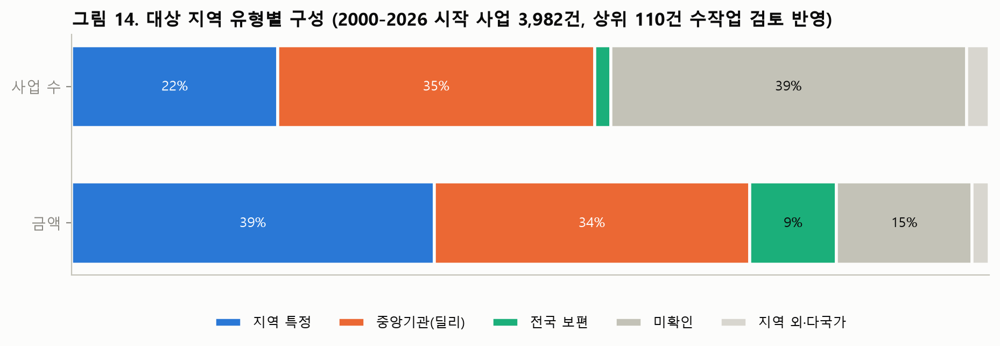
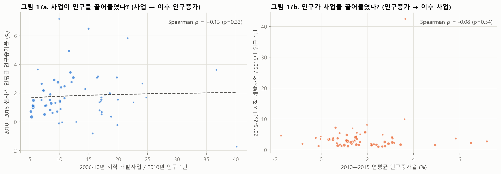
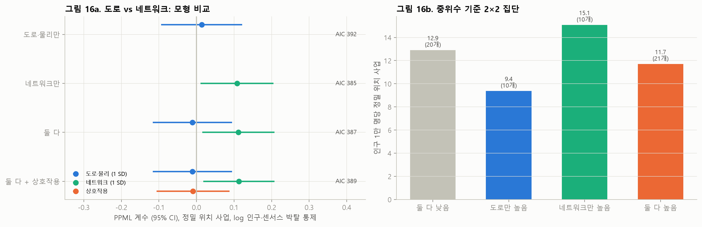
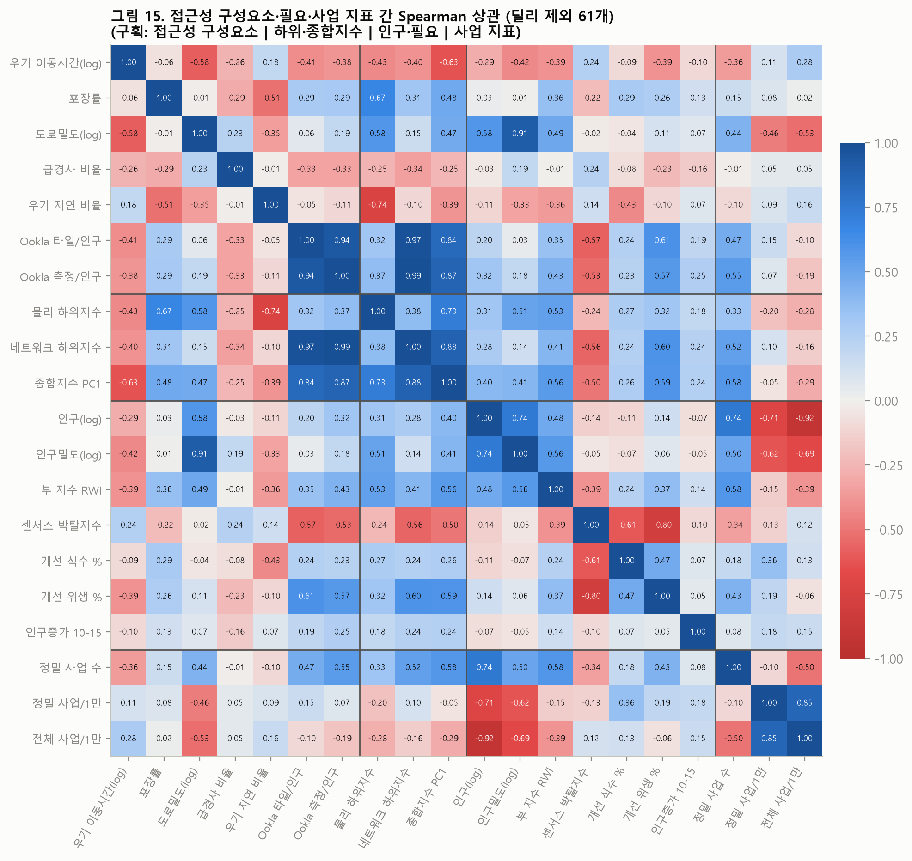
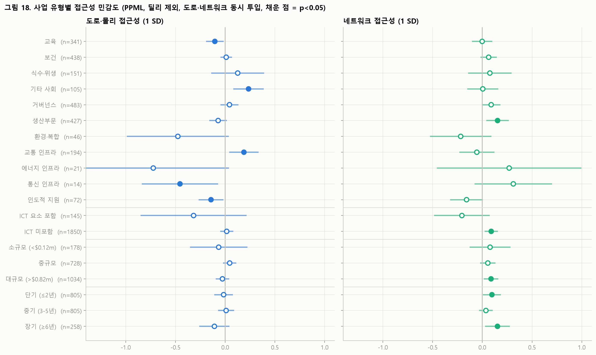
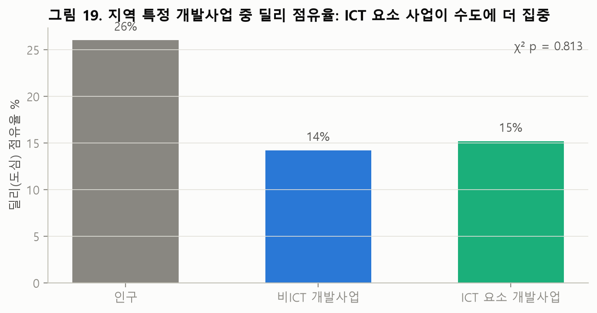
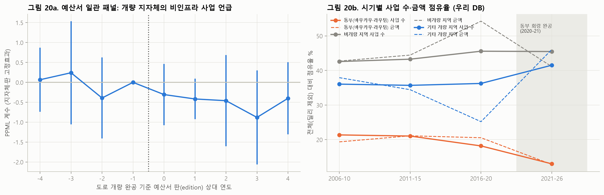
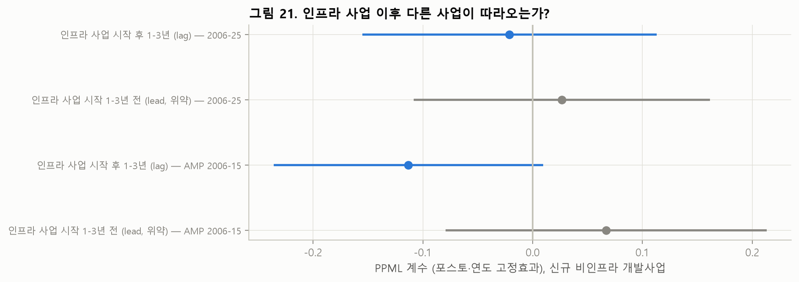
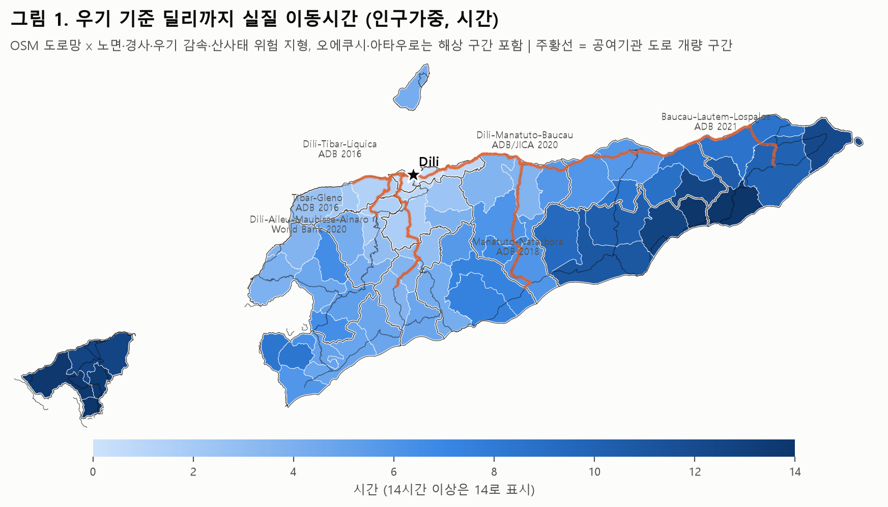
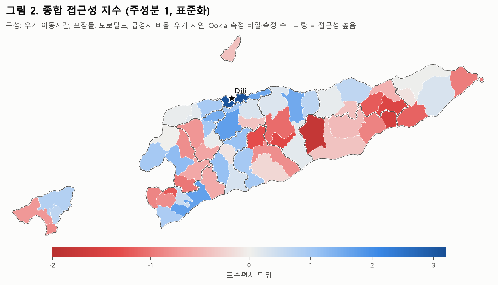
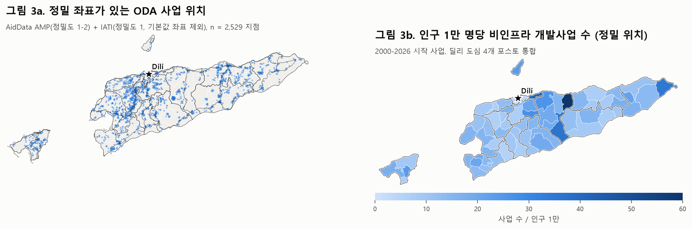
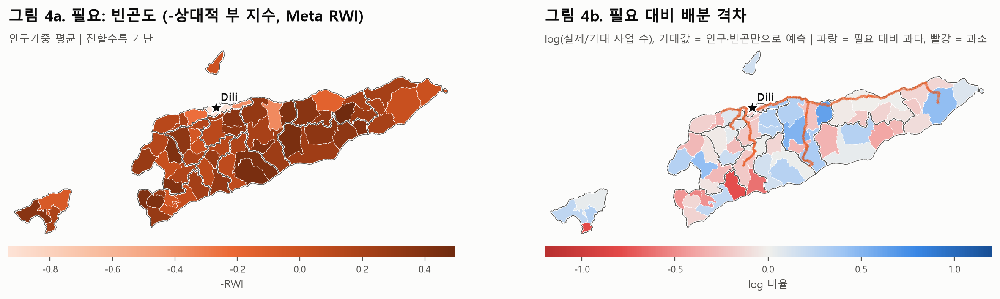
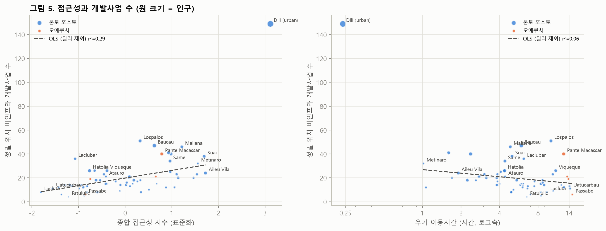
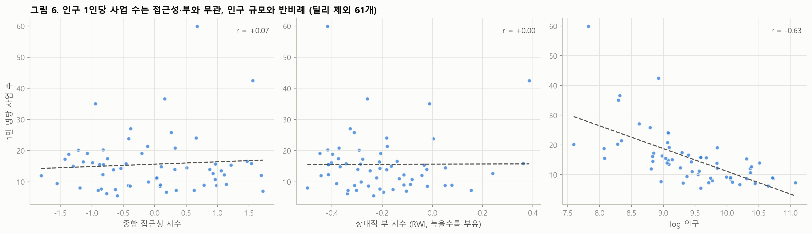
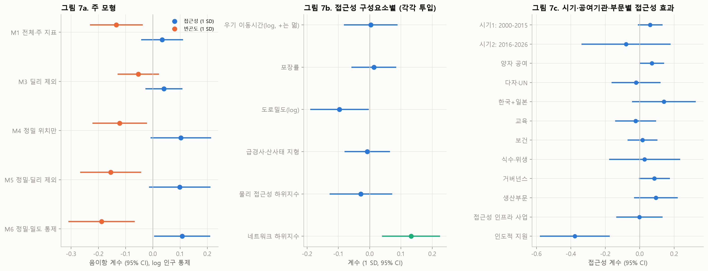
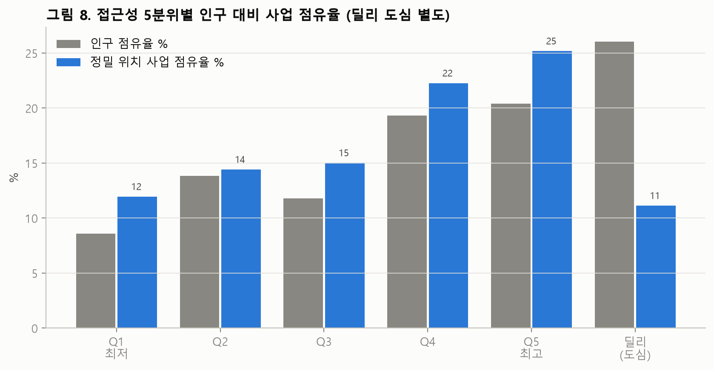
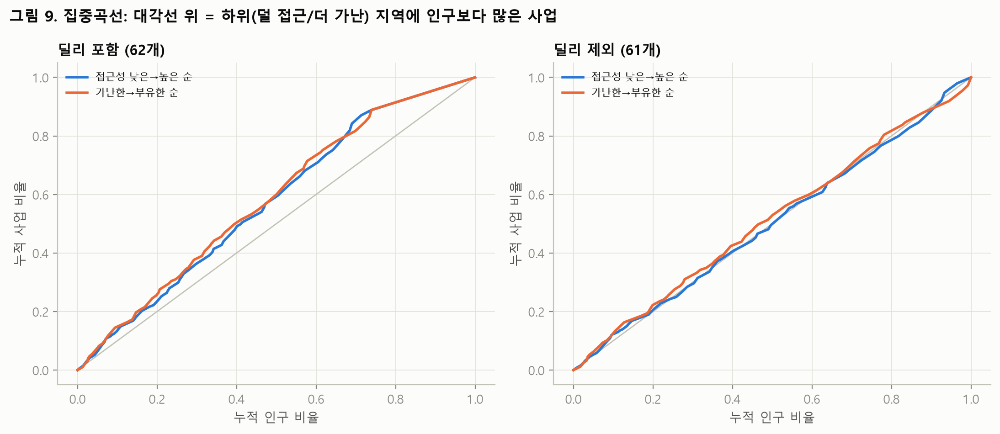
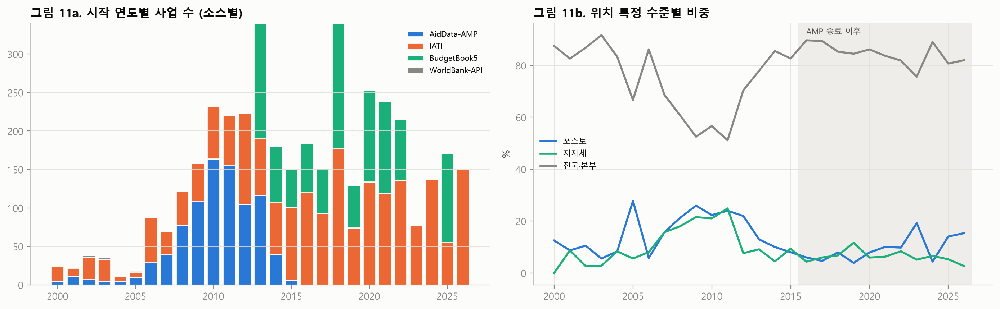
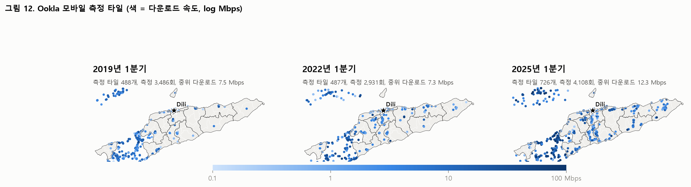
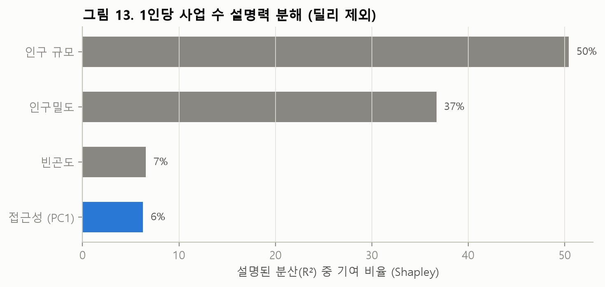

### 결과 원문과 코드
- 결과 출력: [results_summary.txt](outputs/results_summary.txt)(주 모형), [results_simple.txt](outputs/results_simple.txt)(단순 통계), [results_extensions.txt](outputs/results_extensions.txt)(확장 분석 A–G), [facts.txt](outputs/facts.txt)
- 결과표: [outputs/tables/](outputs/tables/). `ext_*` = 확장 분석, `manual_target_codes_with_titles.csv` = 수작업 코딩 근거, `geoparse_audit.csv` = 지명 추출 감사
- 실행 순서:
  1. `fetch1~3.py`, `fetch_ookla.py`, `fetch_census*.py`
  2. `s00_census.py`
  3. `s01_covariates.py`
  4. `s02_access.py`
  5. `s03a_bb5_rows.py`
  6. `s03b_iati_text.py`
  7. `s03_oda.py`
  8. (`dump_unresolved.py`) → `s03c_manual.py`
  9. `s04_build.py`
  10. `s05_models.py`, `s05b_simple.py`, `s08_extensions.py`
  11. `s06_figures.py`, `s09_figures_ext.py`, `s07_facts.py`

### 데이터 출처
- 사업 데이터: AidData Timor-Leste AIMS Geocoded v1.4.1, IATI(d-portal.org), World Bank Projects API, 재무부 예산서 Book 5(La'o Hamutuk 아카이브)
- 경계·인구: OCHA COD-AB/COD-PS(HDX), 2010 Census Wall Chart(통계청, Internet Archive 사본), Wikidata/Wikipedia(2015·2022 센서스 인용), WorldPop
- 필요·환경: Meta Relative Wealth Index, Copernicus GLO-90, WorldClim 2.1
- 접근성: OpenStreetMap(Geofabrik), Ookla Speedtest Open Data
- 도로 완공 연도: ADB·세계은행 사업 문서
