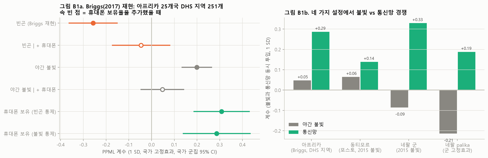

# 보강 분석과 Briggs 재현·반박 검정

작성일 2026-11-01 · 대상: "원조는 밝은(부유한) 곳으로 간다"는 선행연구 결과를 통신 연결성으로 설명할 수 있는가

---

## 요약

| 설정 | 단위 | 불빛 단독 | 불빛 + 통신망 | 통신망 | 판정 |
|---|---|---|---|---|---|
| **아프리카 (Briggs 2017 재현)** | DHS 지역 251개, 25개국 | +0.199 (p < 0.001) | **+0.048 (p = 0.33)** | **+0.287 (p < 0.001)** | 통신망이 불빛 효과의 76%, **빈곤 효과의 136%**를 설명 |
| 동티모르 | 포스토 61개 | +0.071 (2015, p = 0.13) | +0.065 (p = 0.10) | +0.139 (p = 0.007) | 통신망 견고, 불빛 효과 일부 잔존 (통신망이 33–41% 설명) |
| 네팔 군 | 군 72개 | +0.011 (p = 0.87) | −0.085 | +0.329 (p = 0.007) | 통제 후 불빛 효과 자체가 없음, 통신망 견고 |
| 네팔 palika | 지방정부 745곳, 군 고정효과 | −0.124 (p = 0.21) | −0.214 (p = 0.019) | +0.188 (p < 0.001) | 같은 군 안에서는 통신망만 양(+) |

모두 PPML, 1 SD 기준이다.

**결론**:
- 네 가지 설정 모두에서 **통신망 접근성이 사업 입지의 가장 일관된 예측변수**다.
- **Briggs의 "가난한 지역이 덜 받는다"는 아프리카 자료에서 그대로 재현된다. 그러나 사업 이전 시점의 가구 휴대폰 보유율을 통제하면 그 효과가 사라진다**(−0.257 → −0.046).
- 이 결과는 Briggs의 결론을 반박한다기보다 **재해석**한다. 겉보기의 "부유 지역 편향"은 상당 부분 "연결된 지역 편향"이다.
- 다만 불빛 효과가 통신망으로 완전히 대체되는지는 국가마다 다르다. 아프리카에서는 대부분 대체되고, 동티모르에서는 일부만 대체되며, 네팔에서는 처음부터 불빛 효과가 없다.

---

## 1. Briggs (2017) 재현과 확장

### 1.1 설계
| 항목 | 내용 |
|---|---|
| 단위 | 사하라 이남 아프리카 26개국의 DHS 1차 조사 지역(국가별 2006–2011년 최신 DHS 표준조사). 사업이 0건인 1개국은 PPML 분리 문제로 제외 → 25개국 251개 지역 |
| 결과 | **조사 이후 승인된** 세계은행 사업 수(AidData 세계은행 지오코딩 v1.4.2, 정밀도 1–2, 2014년까지) |
| 빈곤 (Briggs 지표) | DHS "최하위 부 5분위 인구 비율" |
| 통신망 (관측값) | DHS "휴대폰 보유 가구 비율", 사업 이전 시점 측정 |
| 기타 | 전기 보급 가구 비율, 2010년 야간 불빛(면적당), WorldPop 2010 인구 |
| 추정 | PPML, 국가 고정효과, 국가 군집 표준오차. Gelbach(2016) 분해는 OLS log(1+사업 수)에 국가 단위 부트스트랩 400회 |

### 1.2 결과 (PPML, 1 SD)

| 모형 | 빈곤 | 불빛 | 휴대폰 | 전기 |
|---|---|---|---|---|
| B1 Briggs 재현 | **−0.257 (< 0.001)** | | | |
| B2 + 휴대폰 | −0.046 (0.48) | | **+0.308 (< 0.001)** | |
| B3 + 전기 | −0.045 | | +0.177 (0.14) | +0.122 (0.12) |
| B4 불빛만 | | **+0.199 (< 0.001)** | | |
| B5 불빛 + 휴대폰 | | +0.048 (0.33) | **+0.287 (< 0.001)** | |
| B6 불빛 + 휴대폰 + 전기 | | +0.012 (0.82) | +0.207 (0.046) | +0.114 (0.16) |
| B8 B2에서 가장 밝은(수도) 지역 제외 | −0.004 | | +0.314 (0.010) | |

**Gelbach 분해**

| 대상 계수 | 추가 변수 | 설명 비율 (부트스트랩 SE) |
|---|---|---|
| 빈곤 | 휴대폰 | **136%** (기여 −0.161, SE 0.038) |
| 빈곤 | 휴대폰 + 전기 | 139% (휴대폰 98%, 전기 41%) |
| 불빛 | 휴대폰 | **76%** (기여 +0.116, SE 0.044) |
| 불빛 | 휴대폰 + 전기 | 95% (휴대폰 61%, 전기 35%) |

### 1.3 해석과 한계
- **반박 가능성**: Briggs가 보여준 빈곤 역표적은 사업 이전 시점의 통신 연결성 차이로 거의 모두 설명된다. "부유해서"가 아니라 "연결돼 있어서" 사업이 간다는 해석이 데이터와 더 잘 맞는다.
- **한계 1. 휴대폰과 전기의 공선성(ρ = 0.67)**: 둘을 함께 넣으면 각각의 유의성이 약해진다. 아프리카 자료만으로는 "통신"과 "전기·기반시설 일반"을 깨끗이 분리할 수 없다. 불빛을 함께 넣은 모형(B6)에서는 휴대폰이 유의하게 남는다(p = 0.046).
- **한계 2. 휴대폰 보유는 수요 측 지표**: 커버리지와 구매력이 섞여 있다. 게다가 DHS 부 지수 자체에 휴대폰 보유가 자산 항목으로 들어간다. 그래서 "빈곤 효과를 흡수한다"는 결과에는 일부 기계적 성분이 있을 수 있다. 다만 불빛(외부 위성자료)도 76%가 설명된다는 점은 이 문제와 무관하다.
- **재현 범위**: Briggs(2017)의 정확한 표본·연도와 다르고(세계은행만 사용, 아프리카개발은행 제외, 국가별 최신 DHS), Briggs(2018)의 격자 설계는 관측된 과거 통신 격자 자료가 없어 하지 않았다.

---

## 2. 동티모르·네팔 보강

### 2.1 불빛 측정 개선 (DMSP 2010 → VIIRS 계열 2015, 면적당 밝기)
- 동티모르는 2010년 불빛이 0인 포스토가 61개 중 35개였는데, 2015년에는 13개로 줄어 측정이 크게 나아진다.
- **동티모르**:
  - 불빛을 통신망과 함께 넣으면 +0.065 (p = 0.10), 도로까지 넣으면 +0.079 (p = 0.055)다.
  - 통신망은 +0.14–0.17 (p ≤ 0.007)로 견고하다.
  - Gelbach 분해에서 통신망은 불빛 효과의 33–41%를 설명한다.
  - **정정**: 앞서 "불빛 효과가 사라진다"고 한 결과는 '총 밝기'를 썼을 때였다. '면적당 밝기'에서는 불빛 효과가 일부 남는다.
- **네팔(군)**: 박탈·인구·주 고정효과를 통제하면 불빛은 2010·2015 모두 효과가 없다. 통신망은 +0.33–0.40 (p ≤ 0.007)이다.

### 2.2 네팔 palika (745곳, 군 고정효과, 군 군집 표준오차)
- 결과변수는 점 위치 개발사업이다(AIMS·지진 재건·IATI 좌표, 정밀도 1–2).
- 군 고정효과가 센서스 통신망과 박탈을 흡수하므로, 같은 군 안의 차이만 본다.

| 모형 | 불빛 2015 | 통신망 (Ookla) | 도로 (이동시간) | 빈곤 (RWI) |
|---|---|---|---|---|
| 각각 단독 | −0.124 (0.21) | **+0.152 (0.001)** | −0.139 (0.22) | |
| 동시 투입 | −0.193 (0.040) | **+0.191 (< 0.001)** | −0.136 (0.21) | |
| + 빈곤 | −0.211 (0.024) | **+0.187 (< 0.001)** | −0.152 | −0.038 (0.70) |
| 2010 불빛으로 대체 | −0.065 | +0.179 (< 0.001) | −0.181 (0.067) | |

같은 군 안에서는 **통신이 되는 지방정부**가 사업을 받는다. 불빛이 밝거나 도로가 좋은 곳이 아니다. 단 palika 단위 통신망은 Ookla(2019·2025)라 사업보다 나중에 측정됐다.

### 2.3 과거 통신 커버리지 자료를 경쟁 검정에서 쓰지 않은 이유
Koebe 외(2026)의 1km 전 세계 커버리지 지도(1999–2030, Zenodo)는 세 모델 모두 **야간 불빛(우리가 쓰는 것과 같은 Li 외 보정판)과 인구·도로를 입력으로** 커버리지를 추정한다. 이 지도를 통신망 지표로 넣으면 불빛과 통신망의 경쟁이 순환논리가 된다. 그래서 관측 지표만 썼다. 동티모르는 Ookla, 네팔은 센서스와 Ookla, 아프리카는 DHS다.

---

## 3. 페이퍼 주장의 조정

| 처음 주장 | 증거 이후 |
|---|---|
| "밝은 곳 편향은 통신 연결성 때문" | **아프리카에서 강하게 지지**(불빛 효과의 76%, 빈곤 효과의 136% 설명). 동티모르는 부분 지지(33–41%), 네팔은 통제 후 불빛 효과 자체가 없음 |
| "도로가 아니라 통신망" | **네 가지 설정 모두 지지**: 도로는 0 또는 음(−), 통신망은 일관되게 양(+) |
| Briggs 반박 | **"재해석"으로 표현하는 것이 정확하다**. 빈곤 역표적은 재현되지만, 관측된 통신 연결성을 통제하면 대부분 사라진다 |

제목안: *"Connected, not richer: Mobile connectivity explains the subnational wealth bias in aid allocation"*

## 4. 남은 과제
1. 아프리카 분석에 아프리카개발은행 사업(AidData AfDB 지오코딩)을 추가하고, 국가별 2개 시점 DHS로 지역 고정효과 패널을 만든다(휴대폰 보급 변화 → 이후 사업 변화).
2. 휴대폰 보유(수요)와 커버리지(공급)를 분리한다. DHS 클러스터 GPS 자료(등록 필요)와 OpenCelliD 기지국 개설 연도(토큰 필요)를 쓰면 된다. 둘 다 연구자 계정이 필요하다.
3. 사람 검증(동티모르 216건, 네팔 표본 생성)

## 파일
- **결과 원문**: [results_briggs.txt](outputs/results_briggs.txt), [results_boost.txt](outputs/results_boost.txt)
- **표**: [briggs_models.csv](outputs/tables/briggs_models.csv), [briggs_gelbach.csv](outputs/tables/briggs_gelbach.csv), [boost_lights.csv](outputs/tables/boost_lights.csv), [nepal_palika_models.csv](outputs/tables/nepal_palika_models.csv)
- **그림**: [fig_B1_briggs_boost.png](outputs/figures/fig_B1_briggs_boost.png)
- **코드**: `briggs_s01_data.py` → `briggs_s02_models.py`, `s13_boost_lights.py`, `nepal_s02_access.py`(격자 저장) → `nepal_s07_palika.py`, `s14_fig_briggs_boost.py`

