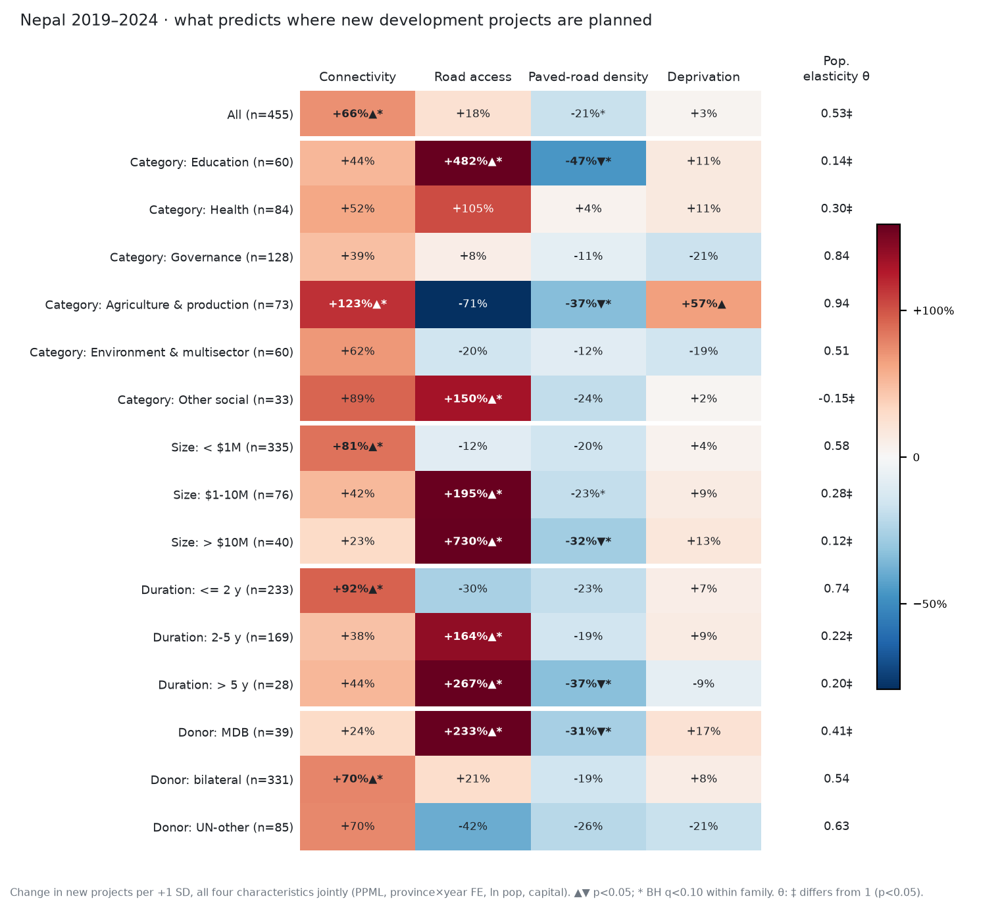
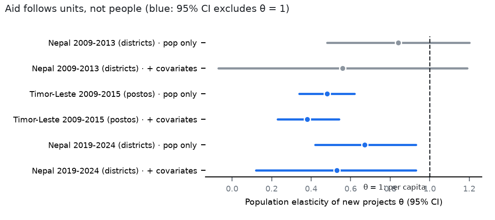

# 종합 보고서 v3: 포뮬라, 카테고리·규모별 분석, 복제 검정

작성 2026-11-01 · 모든 수치는 인간 교차검증 전 잠정치다.

## 0. 세 줄 요약
1. **원조는 '사람'이 아니라 '단위(군·포스토)'를 따라간다.**
   - 인구 탄력성 θ는 세 표본 모두 1보다 작다: 0.38–0.84. 그중 동티모르와 네팔 2019–24는 θ = 1을 유의하게 기각한다.
   - 그래서 인구가 적은 지역일수록 1인당 사업이 많다. 단일 군 사업만 써도 θ ≈ 0.7이라, 균등 분할 때문에 생긴 착시가 아니다.
2. **도로와 필요(박탈)는 사업 수를 설명하지 못한다.**
   - 네팔 두 시기와 동티모르에서 모두 그렇다.
   - 동티모르에서는 박탈이 큰 곳이 오히려 덜 받는다.
3. **'큰 사업일수록 도로를 따른다'는 탐색 결과는 복제에 실패했다.**
   - 네팔 2019–24에서는 강했다(규모 한 단계당 도로 계수 +0.73, p < 0.001, 양자 원조만 써도 유지).
   - 사전등록한 독립 표본 두 곳(네팔 2009–13, 동티모르)에서는 0이었다.
   - 이 결과는 탐색적 발견으로만 보고한다.

## 1. 기본 포뮬라 (처음 연구와 같은 틀, 시점 정렬판)
$$E[N^{c}_{d,t}] = \exp\big(\beta_N Net_{d,t} + \beta_R Road_d + \beta_P Paved_d + \beta_D Dep_d + \theta \ln Pop_{d,t} + \kappa\,Cap_d + \gamma_{p(d),t}\big)$$

| 기호 | 의미 |
|---|---|
| $N^{c}_{d,t}$ | 군 *d*에서 기획연도 *t*에 시작된 하위집단 *c* 사업 수(다군 사업은 균등 분할) |
| $Net$ | 연도별 Ookla 통신 지수. 기획연도와 같은 해 값이다 |
| $Road$ | 건기 이동시간(로그, 부호를 뒤집음) |
| $Paved$ | 포장도로 밀도 |
| $Dep$ | 센서스 박탈 지수 |
| θ | 인구 탄력성. 1이면 인구에 비례해 배분한다는 뜻이다 |
| $\gamma$ | 주×연도 고정효과 |

- 모든 X는 1 SD로 표준화했다. 추정은 PPML, 표준오차는 군 단위 군집이다.
- 인구밀도는 넣지 않았다. ln 인구와 상관이 0.89(VIF 9)라서, 같이 넣으면 사실상 '면적'을 재게 된다. 대신 θ를 직접 해석한다.

## 2. 카테고리·규모·기간·공여기관별 결과 (네팔 2019–24, 455건)

| 하위집단 | 통신 | 도로 | 포장도로 | 박탈 | θ |
|---|---|---|---|---|---|
| 전체 | **+66%** | +18% | −21% | +3% | **0.53** |
| 교육 | +44% | **+482%** | **−47%** | +11% | **0.14** |
| 보건 | +52% | +105% | +4% | +11% | **0.30** |
| 거버넌스 | +39% | +8% | −11% | −21% | 0.84 |
| 농업·생산 | **+123%** | −71% | **−37%** | **+57%** | 0.94 |
| < $1M (335건) | **+81%** | −12% | −20% | +4% | 0.58 |
| $1–10M (76건) | +42% | **+195%** | −23% | +9% | **0.28** |
| > $10M (40건) | +23% | **+730%** | **−32%** | +13% | **0.12** |
| MDB | +24% | **+233%** | **−31%** | +17% | **0.41** |
| 양자 | **+70%** | +21% | −19% | +8% | 0.54 |

- 굵은 글씨: 통신·도로·포장도로·박탈 열은 p < 0.05, θ 열은 θ = 1 기각(p < 0.05).
- 박탈이 양(+)인 유일한 분야는 **농업·생산**이다. 필요를 따라가는 분야다.
- 소규모 사업은 통신이 좋은 거점으로, 대규모 사업은 도로로 가는 **교차 패턴**이 보였다. 그러나 아래 복제 검정에서 재현되지 않았다.

**직관적 분포** ([np2_fig4_concentration.png](outputs/figures/np2_fig4_concentration.png)): 전국 평균을 100으로 둔 1인당 사업 수. 통신 하위 20% 군은 180, 인구밀도가 가장 낮은 20% 군은 289다. 1인당으로 보면 원조는 오지에 더 많이 간다. 이것은 θ < 1의 결과다.

## 3. 사전등록 복제 검정 (가설을 탐색 표본과 분리)
- 계획서: [사전등록_규모기울기_복제.md](사전등록_규모기울기_복제.md)
- 결과 파일: [results_replication_gradient.txt](outputs/results_replication_gradient.txt)

| 표본 | 도로 × 규모 (H1: > 0) | 통신 × 규모 (H2: < 0) | 판정 |
|---|---|---|---|
| 탐색: 네팔 2019–24 | +0.73 (p < 0.001) | −0.34 (p = 0.026) | — |
| R-A: 네팔 2009–13 | +0.12 (단측 p = 0.29) | +0.22 (p = 0.75) | 실패 |
| R-B: 동티모르 2009–15 | −0.08 (p = 0.78) | −0.02 (p = 0.43) | 실패 |

→ 규모 기울기는 **한 표본에서만 나온 발견**이다. 원인 후보는 두 가지다.
- 2019–24의 대형 사업이 소수의 MDB 프로그램에 몰려 있다.
- 시기 특이성: 연방제 이후 도로를 따라 설계된 프로그램이 많다.

## 4. 인구 탄력성 θ: 세 표본 비교

| 표본 | θ (인구만 통제) | θ (공변량 포함) |
|---|---|---|
| 네팔 2009–13 | 0.84 (0.48–1.20) | 0.56 (−0.07–1.19) |
| 동티모르 2009–15 | **0.48 (0.34–0.62)** | **0.38 (0.23–0.54)** |
| 네팔 2019–24 | **0.67 (0.42–0.93)** | **0.53 (0.12–0.93)** |

- 단일 군 사업만 쓰면 0.73(se 0.26), 2–10군 사업을 이진 계수로 세면 0.74(se 0.14)다.
- 국가 간 원조 연구의 **'소국 편향'**(인구가 적은 나라일수록 1인당 원조가 많음)이 국가 내부, 행정단위 수준에서도 나타난다는 해석이 가능하다.
- 메커니즘 후보: 사업이 행정단위 단위로 설계된다(군 단위 사무소, 군별 할당, '모든 군에 하나씩').
- **주의**: θ는 사후 탐색 결과다. 확증하려면 새로 사전등록하고 다른 국가나 시기에서 검정해야 한다.

## 5. 장기 차분 설계 (2011→2021) 현황
- 설계서: [설계_장기차분_2011_2021.md](설계_장기차분_2011_2021.md)
- 센서스 2021 군별 가구 인터넷: NSO 주제보고서 부록 11.1에서 파싱했다. 77개 군, 전국 37.8%로 공식 수치와 일치한다. 파일은 [census2021_district_hh.csv](data/processed/nepal/census2021_district_hh.csv).
- **검정력 부족**: 위치를 확인한 개발사업이 기간당 약 170건뿐이다. 최소탐지효과는 인터넷 10%p당 +85%다.
- 위치 확인 비율 자체가 기간과 군 유형에 따라 다르다. 오지 군의 확인 건수는 P1 34건에서 P2 64건으로 늘었다. 이것도 측정상의 위협이다.
- β 추정(`--estimate`)은 아직 실행하지 않았다. 이 상태로 돌리면 '판별 불가'가 나올 가능성이 높다.

## 6. 판단: 무엇이 '좋고 직관적인' 논문인가
- 지금까지 세 표본에서 **반복된 사실**은 단순하다.
  1. 원조 사업 수는 도로를 따르지 않는다.
  2. 필요(박탈)도 따르지 않는다.
  3. 인구에 비례하지도 않는다. 단위(군)마다 비슷하게 퍼지는 경향이 있다.
- 처음 가설인 '접근성 편향'은 기각된다. 대신 **"단위 균등 배분 편향"**이 드러난다.
- 논문 틀 제안: *"Aid follows districts, not people — or need: subnational evidence from Nepal and Timor-Leste."*
  - 그림 3개로 이야기가 끝난다: 1인당 분포, θ 비교, 효과 행렬.
  - 방법론 기여: 시점 정렬, 문서 기반 기획 시점 코딩.
- **모든 설계의 병목은 위치 확인률(약 20%)**이다. 이것을 높이는 것이 어떤 정교한 모형보다 연구를 좋게 만든다.
  - 전국 단위로 코딩된 사업 중 실제로는 특정 군을 대상으로 하는 사업을 사람이 코딩하면 된다. 이미 만든 한 장 요약 PDF와 검증 시트를 쓸 수 있다.

## 7. 새로 추가된 파일
- 코드: [np2_s10_census2021.py](scripts/np2_s10_census2021.py), [np2_s11_longdiff.py](scripts/np2_s11_longdiff.py), [np2_s12_heterogeneity.py](scripts/np2_s12_heterogeneity.py), [np2_s13_gradient_robust.py](scripts/np2_s13_gradient_robust.py), [np2_s14_replication.py](scripts/np2_s14_replication.py), [np2_s15_pop_elasticity.py](scripts/np2_s15_pop_elasticity.py), [np2_s16_fig_theta.py](scripts/np2_s16_fig_theta.py)
- 결과: [np2_heterogeneity.csv](outputs/tables/np2_heterogeneity.csv), [np2_concentration.csv](outputs/tables/np2_concentration.csv), [results_np2_gradient.txt](outputs/results_np2_gradient.txt), [results_np2_gradient_robust.txt](outputs/results_np2_gradient_robust.txt), [results_pop_elasticity.txt](outputs/results_pop_elasticity.txt), [results_np2_longdiff_power.txt](outputs/results_np2_longdiff_power.txt)
